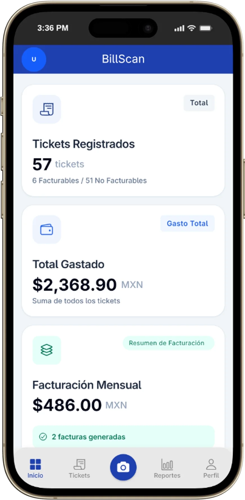
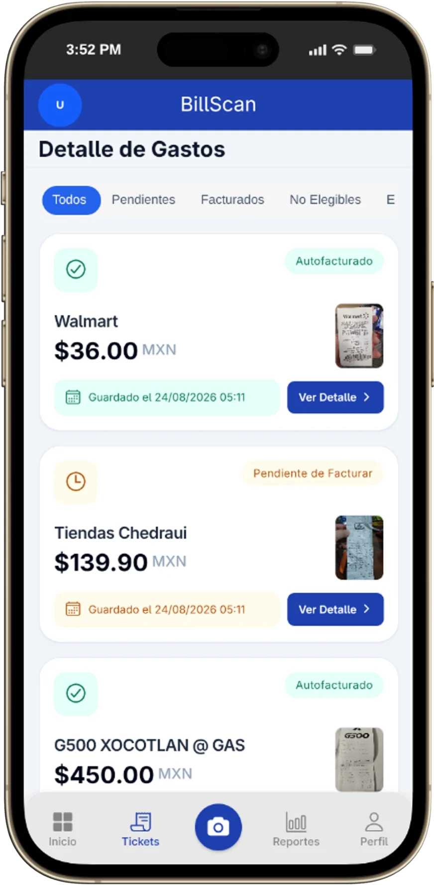
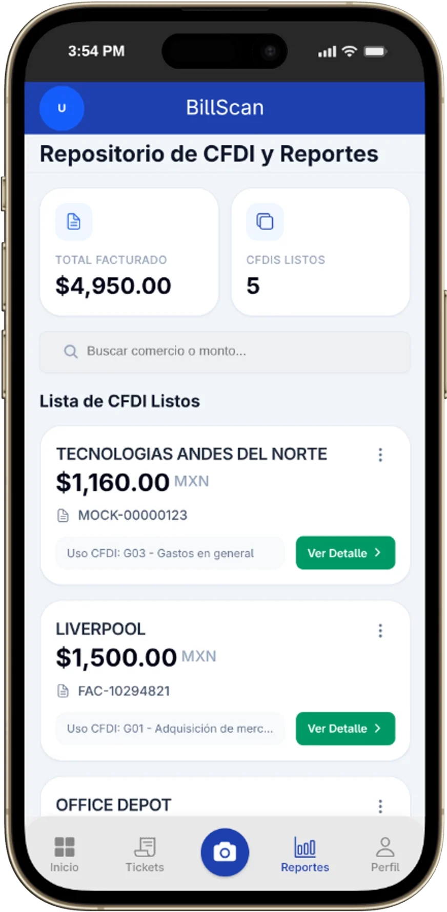
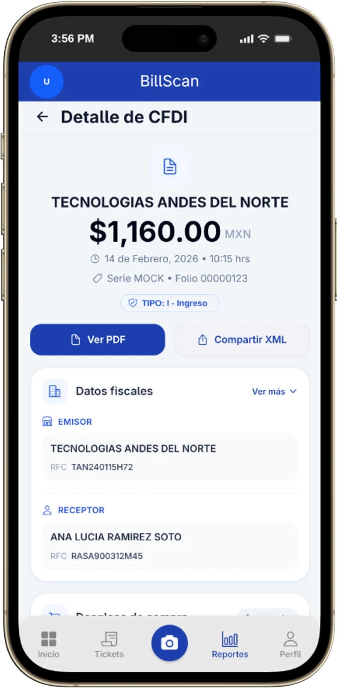
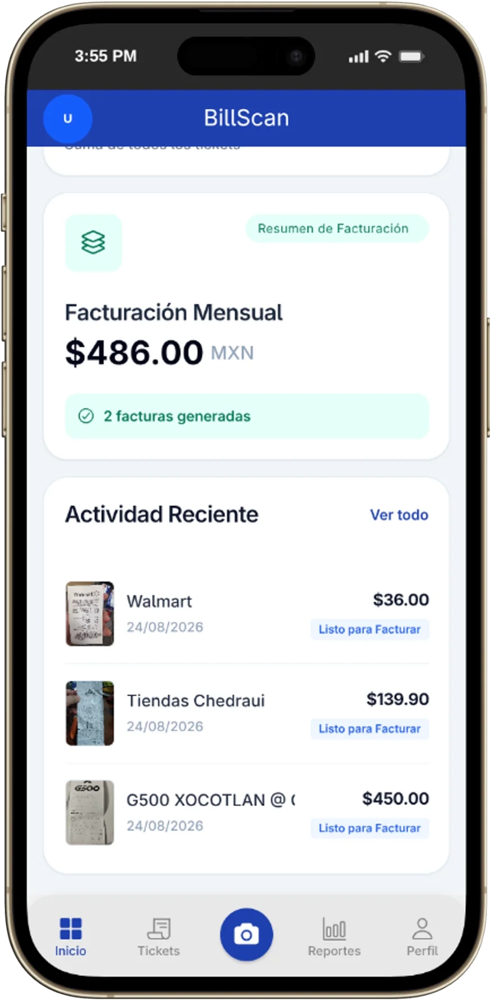
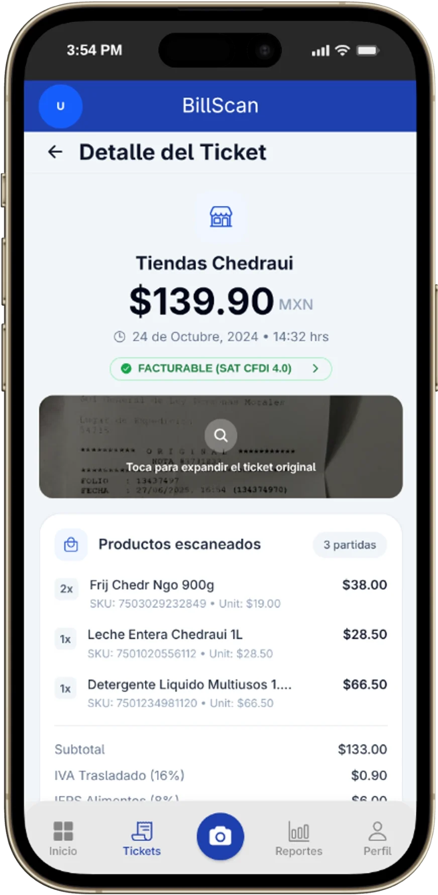
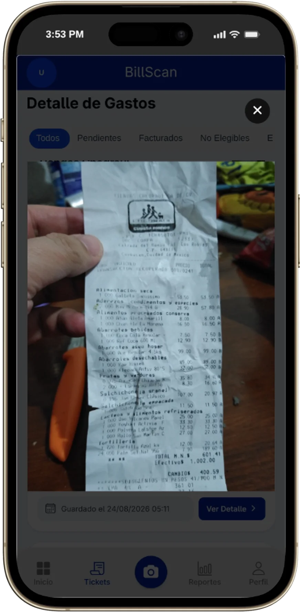
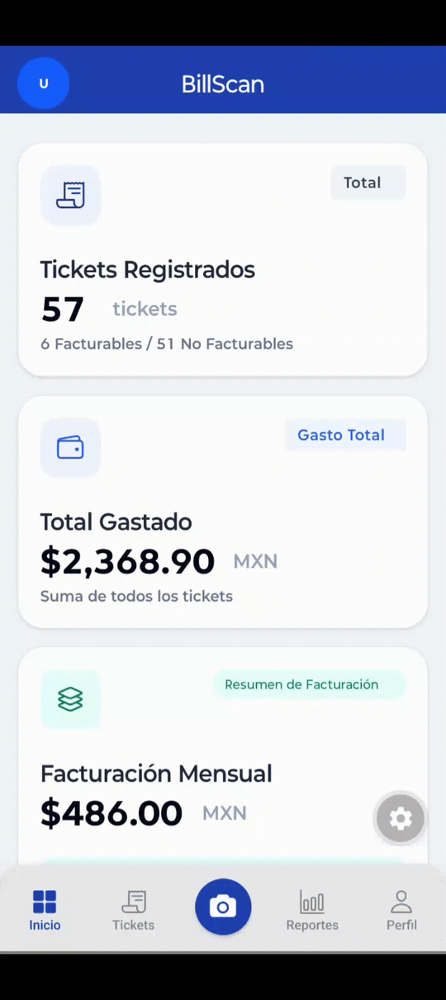

<p align="center">
  
</p>

<h1 align="center">BillScan</h1>

<p align="center">
  Escanea, organiza y consulta tus tickets, facturas y CFDI desde tu teléfono.
</p>

<p align="center">
  
  
  
  <a href="LICENSE"></a>
  
  
</p>

<p align="center">
  <a href="#features">Features</a> ·
  <a href="#stack-tecnológico">Stack</a> ·
  <a href="#arquitectura">Arquitectura</a> ·
  <a href="#instalación-y-configuración">Instalación</a> ·
  <a href="#scripts-disponibles">Scripts</a> ·
  <a href="#roadmap-y-limitaciones-conocidas">Roadmap</a>
</p>

<p align="center">
  
</p>

BillScan convierte los tickets del día a día en un historial ordenado y listo para facturar. Captura una o varias imágenes, guárdalas como ticket o solicita su facturación, y consulta después el CFDI con sus datos fiscales, conceptos, impuestos y certificación del SAT.

Es una app construida con Expo para **Android, iOS y web**, pensada como proyecto de portfolio. Por defecto funciona con datos mock, así que puedes explorarla sin levantar un backend.

> [!NOTE]
> Las capturas y el GIF usan datos, RFC y montos ficticios. No contienen información fiscal real.

## Features

- **Dashboard de gastos:** tickets registrados, total gastado, facturación mensual y actividad reciente.
- **Captura flexible:** escáner de documentos nativo en Android, cámara o galería en iOS y web.
- **Guardar o facturar:** después del escaneo puedes conservar el ticket o solicitar su facturación automática.
- **Repositorio de tickets:** filtros por estado (pendientes, facturados, no elegibles, en proceso y fallidos), detalle de productos, totales, método de pago y visor de la imagen original.
- **Repositorio de CFDI:** búsqueda por comercio, serie/folio o uso de CFDI; detalle con emisor y receptor, conceptos, impuestos y certificación SAT.
- **Datos fiscales:** configuración inicial para capturar RFC, razón social, correo, código postal, régimen fiscal y uso de CFDI predeterminado.
- **Multiplataforma:** Android, iOS y web con Expo; modo mock para desarrollar sin backend.

<h2 align="center">Capturas</h2>

<div align="center">

<table align="center" style="margin-left: auto; margin-right: auto; text-align: center;">
  <tr>
    <td align="center"><p align="center"><strong>Dashboard</strong></p></td>
    <td align="center"><p align="center"><strong>Tickets</strong></p></td>
    <td align="center"><p align="center"><strong>CFDI</strong></p></td>
    <td align="center"><p align="center"><strong>Detalle de CFDI</strong></p></td>
  </tr>
  <tr>
    <td align="center"></td>
    <td align="center"></td>
    <td align="center"></td>
    <td align="center"></td>
  </tr>
</table>

<table align="center" style="margin-left: auto; margin-right: auto; text-align: center;">
  <tr>
    <td align="center"><p align="center"><strong>Actividad reciente</strong></p></td>
    <td align="center"><p align="center"><strong>Detalle de ticket</strong></p></td>
    <td align="center"><p align="center"><strong>Visor de ticket</strong></p></td>
  </tr>
  <tr>
    <td align="center"></td>
    <td align="center"></td>
    <td align="center"></td>
  </tr>
</table>

<p align="center"><sub>Capturas con datos de prueba en un mismo dispositivo y tema.</sub></p>

</div>

### Demo de escaneo

<p align="center">
  
</p>

<p align="center" width="220" height="auto"><sub>Flujo de captura en Android. Si el GIF no carga, <a href=".github/assets/screenshots/BillScanRecord.gif">ábrelo directamente</a>.</sub></p>

## Stack tecnológico

| Capa | Tecnología |
| --- | --- |
| App | Expo SDK 57, React Native 0.86.3, React 19.2 |
| Rutas | expo-router 57 |
| UI | Gluestack UI 5, NativeWind 5 RC, Tailwind CSS 4 |
| Estado y datos | TanStack Query 5 |
| Formularios | React Hook Form 7 + Zod 4 |
| Captura | expo-camera, expo-image-picker, @dariyd/react-native-document-scanner |
| Animación | react-native-reanimated 4, react-native-svg |
| Build | EAS Build / EAS Submit |
| Lenguaje | TypeScript 6 en modo `strict` |

## Arquitectura

```text
billscan-react-native/
├── app/                        Rutas y pantallas (expo-router)
│   ├── (tabs)/                 Inicio, tickets, cámara, reportes y perfil
│   ├── modal.tsx
│   └── _layout.tsx             Providers: QueryClient, Gluestack y captura
├── src/
│   ├── features/
│   │   ├── capture/            Escaneo, selección y carga de imágenes
│   │   ├── fiscal-info/        Datos fiscales y configuración inicial
│   │   ├── invoices/           Listado y detalle de CFDI
│   │   ├── receipts/           Listado y detalle de tickets
│   │   └── reports/            Métricas del dashboard
│   ├── shared/                 Componentes, errores, HTTP client y entorno
│   └── utils/                  Formateadores de moneda, fechas y texto
├── components/ui/              Componentes base de Gluestack UI
├── assets/                     Logo, iconos, splash y fuentes
└── .github/assets/screenshots/ Capturas y GIF del README
```

Cada feature se organiza en capas:

- `application/`: hooks, DTOs y view models que preparan los datos para la UI.
- `domain/`: puertos, enums y value objects del negocio.
- `infrastructure/`: adaptadores HTTP y mock, repositorios, esquemas y factorías.

Las factorías eligen entre el adaptador mock y el HTTP según `EXPO_PUBLIC_USE_MOCKS`. Así la UI y los componentes no conocen el origen de los datos.

### Contrato HTTP

Todo se consume contra `EXPO_PUBLIC_API_URL`:

| Método | Endpoint | Uso |
| --- | --- | --- |
| `GET` | `/reporting/receipts/count` | Conteo de tickets facturables y no facturables |
| `GET` | `/reporting/completed-billing?period=month` | Facturación mensual |
| `GET` | `/reporting/recent-activity` | Actividad reciente del dashboard |
| `GET` | `/receipts?page=1&page_size=20&status=...` | Listado de tickets y filtro por estado |
| `GET` | `/receipts/{receipt_uuid}` | Detalle de ticket |
| `POST` | `/receipts` | Carga multipart de imágenes (`files[]`, `auto_billing`) |
| `GET` | `/cfdis?page=1&page_size=20` | Listado de CFDI |
| `GET` | `/cfdis/{receipt_uuid}` | Detalle de CFDI |
| `GET` / `POST` | `/fiscal-info` | Consulta y alta de datos fiscales |

## Requisitos

- Node.js 20 o superior y npm.
- Android Studio con SDK y emulador, o un dispositivo Android.
- Xcode y CocoaPods para compilar en iOS (solo macOS).
- Cuenta de Expo/EAS para builds en la nube.
- Backend de BillScan si vas a usar `EXPO_PUBLIC_USE_MOCKS=false`.
- Un **development build** para Android: el escáner nativo no funciona en Expo Go.

## Instalación y configuración

```bash
git clone https://github.com/PJMP4826/billscan-react-native.git
cd billscan-react-native
npm install
cp .env.example .env.local
npm start
```

- `npm install` usa el `.npmrc` del repo (`legacy-peer-deps=true`) para resolver las dependencias en release candidate.
- `.env.local` está ignorado por git. Si cambias las variables, reinicia Metro con `npx expo start --clear`.
- Con `EXPO_PUBLIC_USE_MOCKS=true` la app arranca sin backend.
- En un dispositivo físico, usa la IP LAN de tu computadora en `EXPO_PUBLIC_API_URL`, no `localhost`.

## Variables de entorno

Crea `.env.local` a partir de `.env.example`:

| Variable | Obligatoria | Descripción | Ejemplo |
| --- | :---: | --- | --- |
| `EXPO_PUBLIC_API_URL` | Sí, si `USE_MOCKS=false` | URL base del API, incluyendo el prefijo `/api` y sin slash final. | `http://192.168.1.50:8000/api` |
| `EXPO_PUBLIC_USE_MOCKS` | No | `true` usa adaptadores mock locales; `false` consume el API real. | `true` |

> [!IMPORTANT]
> Las variables `EXPO_PUBLIC_*` se incluyen en el bundle del cliente. No pongas secretos, llaves privadas ni tokens en ellas.

## Scripts disponibles

| Comando | Qué hace |
| --- | --- |
| `npm start` | Inicia Metro / Expo. |
| `npm run android` | Compila y ejecuta el development build en Android. |
| `npm run ios` | Compila y ejecuta el development build en iOS. |
| `npm run web` | Inicia la versión web con Metro. |
| `npx tsc --noEmit` | Comprueba tipos sin generar archivos. |

`package.json` todavía no define scripts de lint ni de test.

## Build y release (EAS)

El repo incluye `eas.json` con los perfiles `development`, `preview` y `production`, además del `projectId` de EAS.

```bash
npm install -g eas-cli
eas login
eas build -p android --profile preview
eas build -p ios --profile preview
```

| Perfil | Uso | Distribución |
| --- | --- | --- |
| `development` | Development client con `expo-dev-client` | Interna |
| `preview` | Build de prueba para QA | Interna |
| `production` | Release con incremento automático de versión | Tiendas |

Para enviar una build a las tiendas:

```bash
eas submit -p android --profile production
eas submit -p ios --profile production
```

## Testing, lint y typecheck

```bash
npx tsc --noEmit
```

- TypeScript está en modo `strict` y extiende `expo/tsconfig.base`; el alias `@/*` apunta a la raíz del proyecto.
- No hay runner de tests ni configuración de ESLint/Prettier en el repo todavía. `components/__tests__/` es parte del template de Expo y no está conectado a un script.
- Antes de abrir un PR, ejecuta el typecheck y prueba el flujo afectado en Android, iOS o web.

## Roadmap y limitaciones conocidas

### Roadmap

- [ ] Tests unitarios para hooks, formateadores y adaptadores.
- [ ] Configurar ESLint/Prettier y CI con typecheck y tests.
- [ ] Implementar descarga de PDF y compartición de XML (hoy son solo UI).
- [ ] Completar la pantalla de perfil.
- [ ] Paginación y búsqueda del lado del servidor en tickets y CFDI.
- [ ] Exportación de reportes.
- [ ] Publicación en Play Store y App Store.

### Limitaciones conocidas

- Los botones **Ver PDF** y **Compartir XML** del detalle de CFDI aún son placeholders.
- La pantalla **Perfil** es un placeholder; la configuración fiscal ya funciona desde el modal inicial.
- Los listados cargan la primera página (20 elementos) y la búsqueda de CFDI es local sobre esos datos.
- El escáner nativo de documentos solo está integrado en Android; en iOS y web se usa cámara o galería.
- No hay autenticación ni persistencia local en el cliente; el estado se apoya en el API y en TanStack Query.
- El modo mock usa URLs externas para las imágenes de tickets, así que necesita red para mostrarlas.

## Contribución

Las contribuciones son bienvenidas.

1. Haz un fork y crea una rama desde `main`.
2. Usa mensajes de commit estilo Conventional Commits, por ejemplo `feat(invoices): agrega filtro por estado`.
3. Ejecuta `npx tsc --noEmit` y prueba el flujo que cambiaste.
4. Abre un pull request describiendo el cambio y, si aplica, adjunta capturas.

Para bugs o ideas, abre un issue con pasos para reproducir, plataforma y versión de la app.

## Licencia y contacto

Distribuido bajo la licencia **MIT**. Consulta [LICENSE](LICENSE).

Mantenedor: [@PJMP4826] (Fausto Mendoza) (https://github.com/PJMP4826) · Issues: [github.com/PJMP4826/billscan-react-native/issues](https://github.com/PJMP4826/billscan-react-native/issues)
