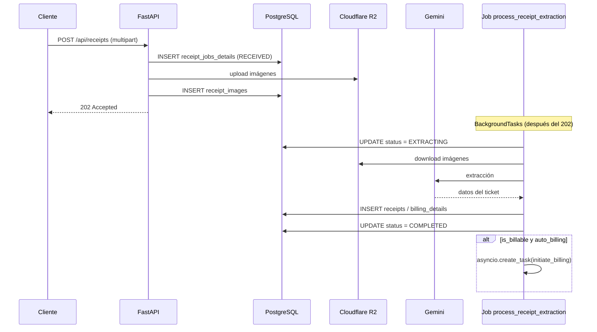
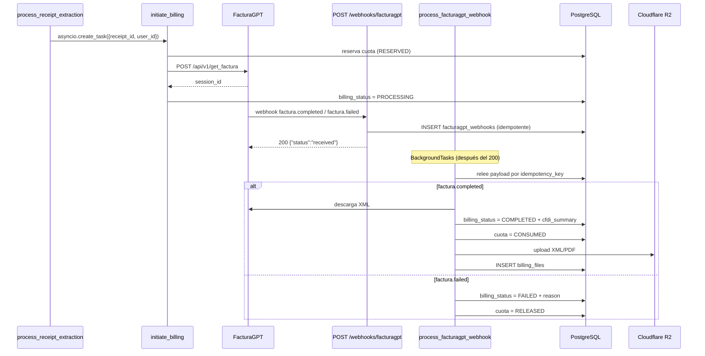

# BillScan API

API REST para la facturación de tickets de compra. Recibe imágenes de tickets, las procesa con un modelo de lenguaje para extraer los datos del comercio y del ticket, y solicita la emisión del CFDI a un proveedor externo de facturación (FacturaGPT). El resultado de la facturación se recibe de forma asíncrona mediante webhooks.

---

## Tabla de contenidos

1. [Descripción general](#descripción-general)
2. [Arquitectura](#arquitectura)
3. [Autenticación](#autenticación)
4. [Resumen de endpoints](#resumen-de-endpoints)
5. [Formato estándar de respuestas de error](#formato-estándar-de-respuestas-de-error)
6. [Documentación de endpoints](#documentación-de-endpoints)
   - [`GET /`](#get-)
   - [`POST /api/receipts`](#post-apireceipts)
   - [`GET /api/receipts`](#get-apireceipts)
   - [`GET /api/receipts/{receipt_uuid}`](#get-apireceiptsreceipt_uuid)
   - [`GET /api/cfdis`](#get-apicfdis)
   - [`GET /api/cfdis/{receipt_uuid}`](#get-apicfdisreceipt_uuid)
   - [`POST /api/fiscal-info`](#post-apifiscal-info)
   - [`POST /api/fiscal-info/csf`](#post-apifiscal-infocsf)
   - [`GET /api/fiscal-info`](#get-apifiscal-info)
   - [`GET /api/fiscal-info/regimens`](#get-apifiscal-inforegimens)
   - [`GET /api/reporting/receipts/count`](#get-apireportingreceiptscount)
   - [`GET /api/reporting/completed-billing`](#get-apireportingcompleted-billing)
   - [`GET /api/reporting/recent-activity`](#get-apireportingrecent-activity)
   - [`POST /webhooks/facturagpt`](#post-webhooksfacturagpt)
7. [Procesamiento asíncrono y documentación de jobs](#procesamiento-asíncrono-y-documentación-de-jobs)
8. [Catálogo de excepciones](#catálogo-de-excepciones)
9. [Errores HTTP genéricos](#errores-http-genéricos)
10. [Mapeo de estados de jobs y códigos de error](#mapeo-de-estados-de-jobs-y-códigos-de-error)
11. [Diagramas de ejecución asíncrona](#diagramas-de-ejecución-asíncrona)
12. [Limitaciones e inconsistencias conocidas](#limitaciones-e-inconsistencias-conocidas)
13. [Elementos pendientes de verificación](#elementos-pendientes-de-verificación)

---

## Descripción general

BillScan expone dos superficies HTTP:

- **API HTTP autenticada** bajo el prefijo `/api`, protegida con tokens JWT emitidos por Clerk. Cubre la captura de tickets (multipart), la información fiscal del usuario (incluyendo extracción desde la Constancia de Situación Fiscal), la consulta de CFDI emitidos y reportes agregados.
- **Webhooks** bajo `/webhooks`, autenticados mediante firma HMAC (`FacturaGPT`), que reciben de forma asíncrona el resultado de las solicitudes de facturación.

El flujo de negocio principal es:

1. El cliente sube uno o más tickets (`POST /api/receipts`).
2. La API responde de inmediato con `202` y encola un job `process_receipt_extraction` por grupo de archivos.
3. El job extrae los datos con Gemini, persiste el ticket y, si el ticket es facturable y el cliente lo solicitó (`auto_billing=true`), dispara el job `initiate_billing`.
4. `initiate_billing` reserva cuota de facturación por RFC y envía la solicitud a FacturaGPT.
5. FacturaGPT devuelve el resultado mediante `POST /webhooks/facturagpt`, que encola el job `process_facturagpt_webhook`.
6. El cliente consulta el estado y los CFDI resultantes mediante `GET /api/receipts`, `GET /api/receipts/{receipt_uuid}`, `GET /api/cfdis` y `GET /api/cfdis/{receipt_uuid}`.

## Arquitectura

Arquitectura por capas con separación entre dominio, aplicación, infraestructura y presentación HTTP:

| Capa | Ubicación | Responsabilidad |
|---|---|---|
| Presentación HTTP | `api/` | Routers, controladores, validación de requests, dependencias de autenticación, middlewares y handlers de excepción. |
| Aplicación | `src/application/` | Casos de uso, comandos y DTOs. |
| Dominio | `src/domain/` | Entidades, enums, value objects, puertos (repositorios y servicios), validadores y errores. |
| Infraestructura | `src/infrastructure/` | Repositorios PostgreSQL, adaptadores de storage (Cloudflare R2 / disco), LLM (Gemini), Clerk, FacturaGPT, almacenamiento cifrado (Fernet), colas y handlers de jobs. |
| Bootstrap / configuración | `src/bootstraps/`, `src/config/` | Inyección de dependencias, ciclo de vida de la app y settings. |

**Stack verificado** (`requirements.txt`, `Dockerfile`):

- Python 3.13 (imagen `python:3.13-slim`).
- FastAPI `0.136.1`, Starlette `1.0.0`, Pydantic `2.13.4`, Uvicorn `0.47.0`.
- PostgreSQL (asyncpg / psycopg2) + SQLAlchemy `2.0.49`; migraciones con Alembic.
- Clerk (`clerk-backend-api`) para autenticación JWT.
- Google Gemini (`google-genai`, `llama-index-*`) para extracción de tickets.
- Cloudflare R2 (compatible S3, vía `boto3`) o disco local para almacenamiento.
- FacturaGPT vía HTTP (`httpx`) como proveedor de facturación.
- Cola en memoria: `fastapi.BackgroundTasks` y `asyncio.create_task`. **No hay Celery, Redis ni scheduler de tareas programadas.**

Documentación interactiva autogenerada por FastAPI: `GET /docs`, `GET /redoc`, `GET /openapi.json`.

## Autenticación

Todos los endpoints `/api/*` requieren `Authorization: Bearer <JWT>` emitido por Clerk (esquema `HTTPBearer`, `auto_error=False`). El webhook `POST /webhooks/facturagpt` **no** usa Bearer; se autentica con firma HMAC.

La dependencia `get_current_user_id` valida el token con el adaptador de Clerk y, a continuación, ejecuta `EnsureUserExistsUseCase`, que crea el registro del usuario si no existe.

### Cabecera requerida

| Header | Valor | Obligatorio | Descripción |
|---|---|---|---|
| `Authorization` | `Bearer <TOKEN>` | Sí | JWT de Clerk. |

### Errores de autenticación

| HTTP Status | `error.code` | Condición |
|---|---|---|
| `401` | `MISSING_AUTHORIZATION_HEADER` | No se envía `Authorization`, o no tiene un esquema/credenciales válidos. |
| `401` | `INVALID_TOKEN` | Clerk rechaza el token, no contiene el claim `sub`, o no se puede resolver el email. El motivo técnico solo se registra en logs. |
| `500` | `INTERNAL_SERVER_ERROR` | Excepción del SDK de Clerk distinta de `AuthenticationError` (p. ej. fallo de red o timeout), no capturada por la dependencia. |

```json
{
  "title": "Unauthorized",
  "status": 401,
  "error_code": "INVALID_TOKEN",
  "message": "Token inválido o expirado",
  "details": {}
}
```

Las respuestas `401` de autenticación incluyen la cabecera `WWW-Authenticate: Bearer`.

## Resumen de endpoints

| Método | Endpoint | Propósito | Status de éxito |
|---|---|---|---|
| `GET` | `/` | Health check simple. | `200` |
| `POST` | `/api/receipts` | Sube uno o más tickets y encola su extracción. | `202` |
| `GET` | `/api/receipts` | Lista paginada de tickets del usuario. | `200` |
| `GET` | `/api/receipts/{receipt_uuid}` | Detalle completo de un ticket. | `200` |
| `GET` | `/api/cfdis` | Lista paginada de CFDI emitidos. | `200` |
| `GET` | `/api/cfdis/{receipt_uuid}` | Detalle del CFDI de un ticket y URLs de XML/PDF. | `200` |
| `POST` | `/api/fiscal-info` | Registra la información fiscal y regímenes del usuario. | `201` |
| `POST` | `/api/fiscal-info/csf` | Registra información fiscal extraída de una CSF. | `201` |
| `GET` | `/api/fiscal-info` | Consulta la información fiscal del usuario. | `200` |
| `GET` | `/api/fiscal-info/regimens` | Lista los regímenes fiscales del RFC del usuario. | `200` |
| `GET` | `/api/reporting/receipts/count` | Resumen de conteos de tickets. | `200` |
| `GET` | `/api/reporting/completed-billing` | Resumen de facturación completada por periodo. | `200` |
| `GET` | `/api/reporting/recent-activity` | Actividad reciente con filtros. | `200` |
| `POST` | `/webhooks/facturagpt` | Recepción de webhooks de FacturaGPT. | `200` |

Los endpoints `/docs`, `/redoc` y `/openapi.json` son rutas automáticas de FastAPI y no forman parte del contrato de negocio.

## Formato estándar de respuestas de error

La aplicación registra cuatro handlers globales:

1. `BaseAppException` (y todas sus subclases).
2. `fastapi.HTTPException`.
3. `RequestValidationError`.
4. `Exception` (catch-all).

### Envelope de error propio

```json
{
  "title": "Bad Request",
  "status": 400,
  "error_code": "BAD_REQUEST",
  "message": "Descripción legible del error",
  "details": {}
}
```

| Campo | Tipo | Descripción |
|---|---|---|
| `title` | `string` | Frase HTTP estándar correspondiente al status (p. ej. `Bad Request`). |
| `status` | `integer` | Código HTTP. Coincide con el status de la respuesta. |
| `error_code` | `string` | Código de error estable para el cliente. |
| `message` | `string` / objeto | Mensaje legible. En excepciones no públicas se reemplaza por un mensaje genérico. |
| `details` | `object` | Información adicional estructurada. Puede ser `{}`. |

### Regla de visibilidad

Las excepciones tienen un atributo `is_public`:

- `is_public=true`: el cliente recibe el mensaje y `details` reales.
- `is_public=false` (infraestructura, PostgreSQL, LLM y errores del proveedor de facturación): el status HTTP y el `error_code` reales se conservan, pero `message` se sustituye por `"Ocurrió un error interno."` y `details` por `{}`.

### Mapeo global

| Origen | HTTP status | `error_code` | Estructura |
|---|---|---|---|
| `BaseAppException` pública | `http_status` de la excepción | `error_code` de la excepción | Envelope propio |
| `BaseAppException` no pública | `http_status` de la excepción | `error_code` de la excepción | Envelope propio con mensaje genérico |
| `fastapi.HTTPException` con `detail` `dict` | `status_code` | `detail["error_code"]` o `HTTP_ERROR` | Envelope propio |
| `fastapi.HTTPException` con `detail` no `dict` | `status_code` | `HTTP_ERROR` | Envelope propio |
| `RequestValidationError` | `400` (FastAPI nativo usaría `422`) | `VALIDATION_ERROR` | Envelope propio con `details.errors` |
| `Exception` no controlada | `500` | `INTERNAL_SERVER_ERROR` | Envelope propio, mensaje genérico |
| Ruta inexistente | `404` | — | Formato nativo `{"detail":"Not Found"}` |
| Método no permitido | `405` | — | Formato nativo `{"detail":"Method Not Allowed"}` + `Allow` |

### Errores de validación

```json
{
  "title": "Bad Request",
  "status": 400,
  "error_code": "VALIDATION_ERROR",
  "message": "Input should be a valid integer, unable to parse string as an integer",
  "details": {
    "errors": [
      {
        "loc": [
          "query",
          "page"
        ],
        "msg": "Input should be a valid integer, unable to parse string as an integer",
        "type": "int_parsing"
      }
    ]
  }
}
```

`message` concatena los mensajes de todos los errores con `"; "`. En `details.errors` solo se conservan `loc`, `msg` y `type`. Un JSON malformado en un endpoint con body declarado también produce `400 VALIDATION_ERROR` con `type: "json_invalid"` y `message: "JSON decode error"`.

### Excepción no controlada

```json
{
  "title": "Internal Server Error",
  "status": 500,
  "error_code": "INTERNAL_SERVER_ERROR",
  "message": "Ocurrió un error interno.",
  "details": {}
}
```

### 404 y 405

No existe un handler personalizado para los `404`/`405` que genera el router de Starlette; por eso estas respuestas **no usan el envelope propio**:

```json
{
  "detail": "Not Found"
}
```

```json
{
  "detail": "Method Not Allowed"
}
```

El `405` incluye la cabecera `Allow` con los métodos permitidos. Un `401` emitido mediante `BaseAppException` incluye `WWW-Authenticate: Bearer`; un `401` emitido mediante `fastapi.HTTPException` no lo incluye.

### Logging

- `BaseAppException` con status `>= 500`: log `ERROR` con traceback.
- `BaseAppException` con status `< 500`: log `WARNING`.
- `Exception` no controlada: log `ERROR` con traceback.
- `HTTPException`, `RequestValidationError`, `404` y `405`: sin log propio del handler (solo el access log de Uvicorn).

---

## Documentación de endpoints

### `POST /api/receipts`

**Propósito:** Sube uno o más tickets (imágenes JPG/PNG), los agrupa y encola su extracción asíncrona. Responde `202` inmediatamente; el procesamiento ocurre después de la respuesta.

**Content-Type:** `multipart/form-data`.

**Autenticación:** Bearer (Clerk).

#### Request Body (multipart/form-data)

| Parte | Tipo | Obligatorio | Valor predeterminado | Descripción |
|---|---|---|---|---|
| `files[]` | `file` (repetible) | No (pero debe haber al menos uno) | `None` | Imágenes del ticket. Se aceptan `image/jpeg`, `image/png`, `image/jpg` detectados por contenido (magic bytes). |
| `groups[]` | `string` | No | `None` | Un **único** string con un JSON array (`'["g1","g1"]'`) o CSV (`"g1,g1"`). No es una lista multipart: si se repite la parte, solo se usa la última. |
| `auto_billing` | `boolean` | No | `false` | Si es `true`, se intentará facturar automáticamente si el ticket resulta facturable. |
| `uso_cfdi` | `string` (enum `InvoiceUse`) | No | `None` | Código SAT de uso de CFDI (p. ej. `G03`). |
| `regimen` | `string` (enum `TaxRegime`) | No | `None` | Código SAT de régimen fiscal (p. ej. `612`). |

#### Reglas de validación

- `files[]`: se valida el MIME real con `puremagic` sobre los primeros 2048 bytes. MIME distinto de imagen JPG/PNG → `400 INVALID_FILE_TYPE`; contenido no reconocible → `400 UNRECOGNIZED_FILE`.
- No existen límites propios de tamaño por archivo, cantidad de archivos, dimensiones ni tasa.
- `groups[]`: si es un JSON array, cada elemento se convierte a string. Si no es lista o el JSON es inválido, se interpreta como CSV separado por comas. Si la cantidad de grupos no coincide con la de archivos, se **descartan** los grupos y se usa un grupo por archivo (`"0"`, `"1"`, …).
- `uso_cfdi` y `regimen` son enums `str` case-sensitive. Un valor fuera del enum produce `400 VALIDATION_ERROR`.
- `auto_billing` se parsea como booleano; un valor no interpretable produce `400 VALIDATION_ERROR`.
- Las dependencias de autenticación se ejecutan **antes** del parseo del multipart: sin token, la respuesta es `401` aunque el formulario sea inválido.

#### Ejemplo cURL

```bash
curl -X POST \
  "https://api.example.com/api/receipts" \
  -H "Authorization: Bearer <TOKEN>" \
  -F "files[]=@ticket1.jpg" \
  -F "files[]=@ticket2.png" \
  -F 'groups[]=["g1","g1"]' \
  -F "auto_billing=true" \
  -F "uso_cfdi=G03" \
  -F "regimen=612"
```

#### Respuesta exitosa

**HTTP Status:** `202 Accepted`

```json
{
  "status": 202,
  "message": "Los tickets se están procesando"
}
```

La respuesta **no** incluye `job_id`, `receipt_id`, `receipt_uuid`, estado por archivo ni estado por grupo.

#### Excepciones y respuestas de error

| HTTP Status | `error.code` | Excepción | Condición que la dispara |
|---|---|---|---|
| `400` | `NO_FILES_PROVIDED` | `BadRequestError` | No se recibió ningún archivo (`files[]` ausente o vacío). |
| `400` | `VALIDATION_ERROR` | `RequestValidationError` | `auto_billing` no booleano, `uso_cfdi`/`regimen` fuera del enum, o `files[]` no es un `UploadFile`. |
| `400` | `INVALID_FILE_TYPE` | `InvalidFileTypeError` | MIME detectado distinto de JPG/PNG. |
| `400` | `UNRECOGNIZED_FILE` | `UnrecognizedFileError` | Contenido de archivo no reconocible. |
| `400` | `FISCAL_INFO_REQUIRED` | `FiscalInfoRequiredError` | `auto_billing=true` o `uso_cfdi` presente, y el usuario no tiene información fiscal. |
| `400` | `INVALID_FISCAL_DATA` | `InvalidFiscalDataError` | El RFC registrado no tiene longitud 12/13 al validar uso CFDI. |
| `400` | `UNKNOWN_INVOICE_USE` | `UnknownInvoiceUseError` | `uso_cfdi` válido en el enum pero no soportado por el validador (p. ej. `P01`). |
| `400` | `UNKNOWN_TAX_REGIME` | `UnknownTaxRegimeError` | Régimen registrado pero no soportado por el catálogo del validador (p. ej. `609`, `628`, `629`, `630`). |
| `400` | `INVOICE_USE_TAX_REGIME_MISMATCH` | `InvalidInvoiceUseTaxRegimeCombinationError` | Combinación `uso_cfdi`/`regimen` no permitida. |
| `400` | `INVOICE_USE_NO_COMPATIBLE_REGIMEN` | `NoRegisteredRegimenAllowsInvoiceUseError` | `uso_cfdi` sin `regimen` y ningún régimen registrado es compatible. |
| `400` | `INVOICE_USE_PERSON_TYPE_MISMATCH` | `InvoiceUseNotAllowedForPersonTypeError` | El uso CFDI no aplica al tipo de persona del RFC. |
| `400` | `TAX_REGIME_PERSON_TYPE_MISMATCH` | `TaxRegimeNotAllowedForPersonTypeError` | El régimen no aplica al tipo de persona del RFC. |
| `400` | `REGIMEN_NOT_REGISTERED` | `RegimenNotRegisteredError` | `regimen` no está entre los regímenes registrados del usuario. |
| `400` | `NO_REGISTERED_REGIMENS` | `NoRegisteredRegimensError` | `uso_cfdi`/`regimen` presente y el usuario no tiene regímenes. |
| `401` | `MISSING_AUTHORIZATION_HEADER` | `AuthenticationError` | Sin cabecera `Authorization` válida. |
| `401` | `INVALID_TOKEN` | `AuthenticationError` | Token inválido/expirado. |
| `409` | `INVOICE_QUOTA_EXCEEDED` | `InvoiceQuotaExceededError` | `auto_billing=true` y la cuota por RFC se excede (la cuota se pre-valida pero no se reserva aquí). |
| `500` | `R2_UPLOAD_ERROR` | `InfrastructureException` | Falla la subida a Cloudflare R2 (`ClientError`). |
| `500` | `INFRASTRUCTURE_EXCEPTION` | `InfrastructureException` | No se puede crear/configurar el engine de base de datos. |
| `500` | `POSTGRES_DB_ERROR` | `PostgresDBException` | Falla una escritura/lectura en PostgreSQL. |
| `500` | `INTERNAL_SERVER_ERROR` | `Exception` / error no envuelto | Fallo no controlado (incluye errores de conexión a BD, boto3 fuera de `ClientError`, Fernet o registro de jobs). |

Ejemplo `NO_FILES_PROVIDED`:

```json
{
  "title": "Bad Request",
  "status": 400,
  "error_code": "NO_FILES_PROVIDED",
  "message": "Debes enviar al menos un archivo",
  "details": {}
}
```

Ejemplo `INVALID_FILE_TYPE`:

```json
{
  "title": "Bad Request",
  "status": 400,
  "error_code": "INVALID_FILE_TYPE",
  "message": "Solo se permiten imágenes JPG o PNG",
  "details": {}
}
```

Ejemplo `REGIMEN_NOT_REGISTERED`:

```json
{
  "title": "Bad Request",
  "status": 400,
  "error_code": "REGIMEN_NOT_REGISTERED",
  "message": "El régimen fiscal 601 no está asociado al RFC del usuario",
  "details": {
    "regimen": "601"
  }
}
```

Ejemplo `INVOICE_QUOTA_EXCEEDED`:

```json
{
  "title": "Conflict",
  "status": 409,
  "error_code": "INVOICE_QUOTA_EXCEEDED",
  "message": "Ya usaste 3 de 3 facturas gratis de este RFC; tu solicitud de 1 factura gratis no se procesó.",
  "details": {
    "limit": 3,
    "used": 3,
    "requested": 1,
    "remaining": 0,
    "quota_label": "gratis"
  }
}
```

Ejemplo de error de infraestructura (mensaje oculto por `is_public=false`):

```json
{
  "title": "Internal Server Error",
  "status": 500,
  "error_code": "R2_UPLOAD_ERROR",
  "message": "Ocurrió un error interno.",
  "details": {}
}
```

Resto de ejemplos JSON de las excepciones listadas:

`VALIDATION_ERROR` — `400`:
```json
{
  "title": "Bad Request",
  "status": 400,
  "error_code": "VALIDATION_ERROR",
  "message": "Input should be 'G01', 'G02', ... or 'CN01'",
  "details": {
    "errors": [
      {
        "loc": [
          "body",
          "uso_cfdi"
        ],
        "msg": "Input should be 'G01', 'G02', ... or 'CN01'",
        "type": "enum"
      }
    ]
  }
}
```

`UNRECOGNIZED_FILE` — `400`:
```json
{
  "title": "Bad Request",
  "status": 400,
  "error_code": "UNRECOGNIZED_FILE",
  "message": "Archivo no reconocido",
  "details": {}
}
```

`FISCAL_INFO_REQUIRED` — `400`:
```json
{
  "title": "Bad Request",
  "status": 400,
  "error_code": "FISCAL_INFO_REQUIRED",
  "message": "No hay informacion fiscal asociada a tu usuario. Registra tu informacion fiscal antes de facturar.",
  "details": {}
}
```

`INVALID_FISCAL_DATA` — `400`:
```json
{
  "title": "Bad Request",
  "status": 400,
  "error_code": "INVALID_FISCAL_DATA",
  "message": "La informacion fiscal registrada no es valida",
  "details": {}
}
```

`UNKNOWN_INVOICE_USE` — `400`:
```json
{
  "title": "Bad Request",
  "status": 400,
  "error_code": "UNKNOWN_INVOICE_USE",
  "message": "UsoCFDI 'P01' no existe en c_UsoCFDI o no está soportado.",
  "details": {
    "uso_cfdi": "P01"
  }
}
```

`UNKNOWN_TAX_REGIME` — `400`:
```json
{
  "title": "Bad Request",
  "status": 400,
  "error_code": "UNKNOWN_TAX_REGIME",
  "message": "RegimenFiscal '629' no existe en c_RegimenFiscal o no está soportado.",
  "details": {
    "regimen_fiscal": "629"
  }
}
```

`INVOICE_USE_TAX_REGIME_MISMATCH` — `400`:
```json
{
  "title": "Bad Request",
  "status": 400,
  "error_code": "INVOICE_USE_TAX_REGIME_MISMATCH",
  "message": "El UsoCFDI 'D01' no es válido para el régimen 601",
  "details": {
    "uso_cfdi": "D01",
    "regimen_fiscal": "601",
    "allowed_regimes": [
      "605",
      "606",
      "607",
      "608",
      "611",
      "612",
      "614",
      "615",
      "625"
    ]
  }
}
```

`INVOICE_USE_NO_COMPATIBLE_REGIMEN` — `400`:
```json
{
  "title": "Bad Request",
  "status": 400,
  "error_code": "INVOICE_USE_NO_COMPATIBLE_REGIMEN",
  "message": "Ninguno de los regímenes registrados del usuario permite el UsoCFDI 'G01'.",
  "details": {
    "uso_cfdi": "G01",
    "registered_regimes": [
      "605"
    ],
    "allowed_regimes": [
      "601",
      "603",
      "606",
      "612"
    ]
  }
}
```

`INVOICE_USE_PERSON_TYPE_MISMATCH` — `400`:
```json
{
  "title": "Bad Request",
  "status": 400,
  "error_code": "INVOICE_USE_PERSON_TYPE_MISMATCH",
  "message": "El UsoCFDI 'D01' no aplica para persona moral. Tipos de persona permitidos: FISICA.",
  "details": {
    "uso_cfdi": "D01",
    "tipo_persona": "MORAL",
    "allowed_person_types": [
      "FISICA"
    ]
  }
}
```

`TAX_REGIME_PERSON_TYPE_MISMATCH` — `400`:
```json
{
  "title": "Bad Request",
  "status": 400,
  "error_code": "TAX_REGIME_PERSON_TYPE_MISMATCH",
  "message": "El régimen '601' no aplica para persona fisica.",
  "details": {
    "regimen_fiscal": "601",
    "tipo_persona": "FISICA"
  }
}
```

`NO_REGISTERED_REGIMENS` — `400`:
```json
{
  "title": "Bad Request",
  "status": 400,
  "error_code": "NO_REGISTERED_REGIMENS",
  "message": "No hay regímenes fiscales registrados para el usuario; registra tu informacion fiscal antes de facturar",
  "details": {}
}
```

`MISSING_AUTHORIZATION_HEADER` — `401` (incluye `WWW-Authenticate: Bearer`):
```json
{
  "title": "Unauthorized",
  "status": 401,
  "error_code": "MISSING_AUTHORIZATION_HEADER",
  "message": "Falta el encabezado Authorization",
  "details": {}
}
```

`INVALID_TOKEN` — `401` (incluye `WWW-Authenticate: Bearer`):
```json
{
  "title": "Unauthorized",
  "status": 401,
  "error_code": "INVALID_TOKEN",
  "message": "Token inválido o expirado",
  "details": {}
}
```

`INFRASTRUCTURE_EXCEPTION` — `500`:
```json
{
  "title": "Internal Server Error",
  "status": 500,
  "error_code": "INFRASTRUCTURE_EXCEPTION",
  "message": "Ocurrió un error interno.",
  "details": {}
}
```

`POSTGRES_DB_ERROR` — `500`:
```json
{
  "title": "Internal Server Error",
  "status": 500,
  "error_code": "POSTGRES_DB_ERROR",
  "message": "Ocurrió un error interno.",
  "details": {}
}
```

`INTERNAL_SERVER_ERROR` — `500`:
```json
{
  "title": "Internal Server Error",
  "status": 500,
  "error_code": "INTERNAL_SERVER_ERROR",
  "message": "Ocurrió un error interno.",
  "details": {}
}
```

#### Procesamiento asíncrono

- **Se encola:** un job `process_receipt_extraction` por cada grupo, con payload `{"job_id": <int>, "user_id": "<sub>", "auto_billing": <bool>, "uso_cfdi": "<code>|null", "regimen": "<code>|null"}`.
- **Se devuelve inmediatamente:** `202` con el mensaje `"Los tickets se están procesando"`.
- **Identificador del job:** el `job_id` se crea en `receipt_jobs_details` (`status='RECEIVED'`) pero **no se expone** en la respuesta.
- **Estado inicial:** `RECEIVED`. Las imágenes se insertan en `receipt_images` con `receipt_id=NULL`.
- **Consulta del resultado:** `GET /api/receipts` y `GET /api/receipts/{receipt_uuid}`. Los tickets todavía en `RECEIVED`/`EXTRACTING` no aparecen en la lista porque ésta parte de la tabla `receipts`.
- **Documentación del job:** ver [`process_receipt_extraction`](#job-process_receipt_extraction) y [`initiate_billing`](#job-initiate_billing).

**Nota de atomicidad:** no hay transacción por lote. Si un grupo falla, los grupos anteriores ya quedaron creados y encolados, y sus jobs se ejecutarán aunque la respuesta HTTP sea un error.

---

### `GET /api/receipts`

**Propósito:** Devuelve la lista paginada de tickets del usuario con comercio, fecha, total, estado de facturación y URL prefirmada de la imagen.

**Content-Type:** `application/json`.

**Autenticación:** Bearer (Clerk).

#### Parámetros query

| Parámetro | Tipo | Obligatorio | Valor predeterminado | Descripción |
|---|---|---|---|---|
| `page` | `integer` | No | `1` | Página solicitada. Debe ser `>= 1`. |
| `page_size` | `integer` | No | `20` | Tamaño de página. Debe estar entre `1` y `50`. |

#### Ejemplo cURL

```bash
curl -X GET \
  "https://api.example.com/api/receipts?page=1&page_size=20" \
  -H "Authorization: Bearer <TOKEN>"
```

#### Respuesta exitosa

**HTTP Status:** `200 OK`

```json
{
  "status": 200,
  "data": {
    "receipts": [
      {
        "receipt_uuid": "3f1c9a2e-7b44-4d0e-9a51-2c8e6b7d1f03",
        "nombre_comercio": "Comercio de ejemplo",
        "fecha_registro": "2026-11-19 14:35:02",
        "total": "123.45",
        "estado": "COMPLETED",
        "file_url": "https://<bucket>.r2.cloudflarestorage.com/<objeto>?X-Amz-Signature=..."
      }
    ],
    "total": 42,
    "page": 1,
    "page_size": 20,
    "total_pages": 3
  }
}
```

| Campo | Tipo | Descripción |
|---|---|---|
| `data.receipts[].receipt_uuid` | `string` | Identificador del ticket. |
| `data.receipts[].nombre_comercio` | `string` | Nombre del comercio, o `"Sin comercio"`. |
| `data.receipts[].fecha_registro` | `string` | Fecha con formato `YYYY-MM-DD HH:MM:SS`. |
| `data.receipts[].total` | `string` | Total del ticket serializado como string decimal. |
| `data.receipts[].estado` | `string` | Estado de facturación (`BillingStatus`) o, en su defecto, el estado del último job. |
| `data.receipts[].file_url` | `string` | URL prefirmada de la imagen (expira en 3600 s). |
| `data.total` | `integer` | Total de tickets del usuario. |
| `data.page` / `data.page_size` | `integer` | Eco de los parámetros. |
| `data.total_pages` | `integer` | `ceil(total / page_size)`. |

Lista vacía:

```json
{
  "status": 200,
  "data": {
    "receipts": [],
    "total": 0,
    "page": 1,
    "page_size": 20,
    "total_pages": 0
  }
}
```

#### Excepciones y respuestas de error

| HTTP Status | `error.code` | Excepción | Condición que la dispara |
|---|---|---|---|
| `400` | `VALIDATION_ERROR` | `RequestValidationError` | `page < 1`, `page_size < 1`, `page_size > 50` o valores no enteros. |
| `401` | `MISSING_AUTHORIZATION_HEADER` | `AuthenticationError` | Sin cabecera `Authorization` válida. |
| `401` | `INVALID_TOKEN` | `AuthenticationError` | Token inválido/expirado. |
| `500` | `POSTGRES_DB_ERROR` | `PostgresDBException` | Falla el `COUNT(*)`, el `SELECT` paginado o el upsert del usuario dentro del bloque controlado. |
| `500` | `INFRASTRUCTURE_EXCEPTION` | `InfrastructureException` | No se puede crear el engine de base de datos. |
| `500` | `INVALID_BILLING_STATUS` | `InfrastructureException` | El estado derivado de la fila no pertenece a `BillingStatus` (p. ej. último job `RECEIVED`/`EXTRACTING` o `"UNKNOWN"`). |
| `500` | `R2_PRESIGNED_URL_ERROR` | `InfrastructureException` | `generate_presigned_url` lanza `ClientError`. |
| `500` | `INTERNAL_SERVER_ERROR` | `Exception` | Fallo al adquirir conexión (`engine.connect()` fuera del `try`), errores boto3 no `ClientError`, fallos de configuración del cliente R2 o filas malformadas. |

Ejemplo de validación:

```json
{
  "title": "Bad Request",
  "status": 400,
  "error_code": "VALIDATION_ERROR",
  "message": "Input should be less than or equal to 50",
  "details": {
    "errors": [
      {
        "loc": [
          "query",
          "page_size"
        ],
        "msg": "Input should be less than or equal to 50",
        "type": "less_than_equal"
      }
    ]
  }
}
```

Resto de ejemplos JSON de las excepciones listadas:

`MISSING_AUTHORIZATION_HEADER` — `401` (incluye `WWW-Authenticate: Bearer`):
```json
{
  "title": "Unauthorized",
  "status": 401,
  "error_code": "MISSING_AUTHORIZATION_HEADER",
  "message": "Falta el encabezado Authorization",
  "details": {}
}
```

`INVALID_TOKEN` — `401` (incluye `WWW-Authenticate: Bearer`):
```json
{
  "title": "Unauthorized",
  "status": 401,
  "error_code": "INVALID_TOKEN",
  "message": "Token inválido o expirado",
  "details": {}
}
```

`POSTGRES_DB_ERROR` — `500`:
```json
{
  "title": "Internal Server Error",
  "status": 500,
  "error_code": "POSTGRES_DB_ERROR",
  "message": "Ocurrió un error interno.",
  "details": {}
}
```

`INFRASTRUCTURE_EXCEPTION` — `500`:
```json
{
  "title": "Internal Server Error",
  "status": 500,
  "error_code": "INFRASTRUCTURE_EXCEPTION",
  "message": "Ocurrió un error interno.",
  "details": {}
}
```

`INVALID_BILLING_STATUS` — `500`:
```json
{
  "title": "Internal Server Error",
  "status": 500,
  "error_code": "INVALID_BILLING_STATUS",
  "message": "Ocurrió un error interno.",
  "details": {}
}
```

`R2_PRESIGNED_URL_ERROR` — `500`:
```json
{
  "title": "Internal Server Error",
  "status": 500,
  "error_code": "R2_PRESIGNED_URL_ERROR",
  "message": "Ocurrió un error interno.",
  "details": {}
}
```

`INTERNAL_SERVER_ERROR` — `500`:
```json
{
  "title": "Internal Server Error",
  "status": 500,
  "error_code": "INTERNAL_SERVER_ERROR",
  "message": "Ocurrió un error interno.",
  "details": {}
}
```

**Nota:** `total` cuenta todos los tickets del usuario, pero el listado usa `INNER JOIN receipt_images`; un ticket sin imagen no aparece y uno con varias imágenes puede repetirse. Por ello `total` puede no coincidir con la cantidad de elementos devueltos.

---

### `GET /api/cfdis`

**Propósito:** Devuelve la lista paginada de CFDI emitidos para el usuario.

**Content-Type:** `application/json`.

**Autenticación:** Bearer (Clerk).

#### Parámetros query

| Parámetro | Tipo | Obligatorio | Valor predeterminado | Descripción |
|---|---|---|---|---|
| `page` | `integer` | No | `1` | Página solicitada. Debe ser `>= 1`. No tiene límite superior. |
| `page_size` | `integer` | No | `20` | Tamaño de página. Debe estar entre `1` y `50`. |

#### Ejemplo cURL

```bash
curl -X GET \
  "https://api.example.com/api/cfdis?page=1&page_size=20" \
  -H "Authorization: Bearer <TOKEN>"
```

#### Respuesta exitosa

**HTTP Status:** `200 OK`

```json
{
  "status": 200,
  "data": {
    "cfdis": [
      {
        "receipt_uuid": "3f1c9a2e-7b44-4d0e-9a51-2c8e6b7d1f03",
        "emisor_nombre": "ACME SA",
        "total": "1160.00",
        "serie": "A",
        "folio": "123",
        "uso_cfdi": "G03"
      }
    ],
    "total": 45,
    "page": 1,
    "page_size": 20,
    "total_pages": 3
  }
}
```

| Campo | Tipo | Descripción |
|---|---|---|
| `data.cfdis[].receipt_uuid` | `string` | Identificador del ticket asociado. |
| `data.cfdis[].emisor_nombre` | `string \| null` | Nombre del emisor del CFDI. |
| `data.cfdis[].total` | `string` | Total del CFDI serializado como string decimal. |
| `data.cfdis[].serie` | `string \| null` | Serie del CFDI. |
| `data.cfdis[].folio` | `string \| null` | Folio del CFDI. |
| `data.cfdis[].uso_cfdi` | `string \| null` | Uso de CFDI del receptor. |
| `data.total` | `integer` | Total de CFDI. |
| `data.total_pages` | `integer` | `ceil(total / page_size)`. |

#### Excepciones y respuestas de error

| HTTP Status | `error.code` | Excepción | Condición que la dispara |
|---|---|---|---|
| `400` | `VALIDATION_ERROR` | `RequestValidationError` | `page < 1` o `page_size` fuera de `[1, 50]`, o valores no enteros. |
| `401` | `MISSING_AUTHORIZATION_HEADER` | `AuthenticationError` | Sin cabecera `Authorization` válida. |
| `401` | `INVALID_TOKEN` | `AuthenticationError` | Token inválido/expirado. |
| `500` | `POSTGRES_DB_ERROR` | `PostgresDBException` | Falla el `COUNT(*)`, el `SELECT` paginado, el upsert del usuario, o una conversión de datos dentro del bloque controlado. |
| `500` | `INFRASTRUCTURE_EXCEPTION` | `InfrastructureException` | No se puede crear el engine de base de datos. |
| `500` | `INTERNAL_SERVER_ERROR` | `Exception` / `sqlalchemy.exc.*` | Fallo al adquirir conexión, email vacío del token, SDK Clerk o fallo no controlado. |

Ejemplo de validación:

```json
{
  "title": "Bad Request",
  "status": 400,
  "error_code": "VALIDATION_ERROR",
  "message": "Input should be greater than or equal to 1",
  "details": {
    "errors": [
      {
        "loc": [
          "query",
          "page"
        ],
        "msg": "Input should be greater than or equal to 1",
        "type": "greater_than_equal"
      }
    ]
  }
}
```

Resto de ejemplos JSON de las excepciones listadas:

`MISSING_AUTHORIZATION_HEADER` — `401` (incluye `WWW-Authenticate: Bearer`):
```json
{
  "title": "Unauthorized",
  "status": 401,
  "error_code": "MISSING_AUTHORIZATION_HEADER",
  "message": "Falta el encabezado Authorization",
  "details": {}
}
```

`INVALID_TOKEN` — `401` (incluye `WWW-Authenticate: Bearer`):
```json
{
  "title": "Unauthorized",
  "status": 401,
  "error_code": "INVALID_TOKEN",
  "message": "Token inválido o expirado",
  "details": {}
}
```

`POSTGRES_DB_ERROR` — `500`:
```json
{
  "title": "Internal Server Error",
  "status": 500,
  "error_code": "POSTGRES_DB_ERROR",
  "message": "Ocurrió un error interno.",
  "details": {}
}
```

`INFRASTRUCTURE_EXCEPTION` — `500`:
```json
{
  "title": "Internal Server Error",
  "status": 500,
  "error_code": "INFRASTRUCTURE_EXCEPTION",
  "message": "Ocurrió un error interno.",
  "details": {}
}
```

`INTERNAL_SERVER_ERROR` — `500`:
```json
{
  "title": "Internal Server Error",
  "status": 500,
  "error_code": "INTERNAL_SERVER_ERROR",
  "message": "Ocurrió un error interno.",
  "details": {}
}
```

**Nota:** el listado ordena por `cfdi_summary->>'fecha' DESC` sin desempate, por lo que filas con la misma fecha pueden cambiar de orden entre páginas.

---

### `GET /api/receipts/{receipt_uuid}`

**Propósito:** Devuelve el detalle completo de un ticket (agregado `Receipt`), incluyendo comercio, transacción, ítems, totales, pago, información de facturación y la URL prefirmada de la imagen.

**Content-Type:** `application/json`.

**Autenticación:** Bearer (Clerk).

#### Parámetros de ruta

| Parámetro | Tipo | Obligatorio | Descripción |
|---|---|---|---|
| `receipt_uuid` | `string` | Sí | Identificador del ticket. No se valida formato UUID; cualquier string se usa en la consulta. |

#### Ejemplo cURL

```bash
curl -X GET \
  "https://api.example.com/api/receipts/3f1c9a2e-7b44-4d0e-9a51-2c8e6b7d1f03" \
  -H "Authorization: Bearer <TOKEN>"
```

#### Respuesta exitosa

**HTTP Status:** `200 OK`

```json
{
  "status": 200,
  "data": {
    "receipt_uuid": "3f1c9a2e-7b44-4d0e-9a51-2c8e6b7d1f03",
    "merchant": {
      "name": "Comercio de ejemplo",
      "tax_id": "ABC123",
      "address": "Av. Ejemplo 1",
      "branch_id": "B01",
      "phone": "5555555555"
    },
    "transaction": {
      "transaction_date": "2026-01-15",
      "transaction_time": "13:45:00",
      "ticket_number": "T-001",
      "pos_id": "POS-1",
      "cashier": "Cajero"
    },
    "items": [
      {
        "quantity": 2.0,
        "description": "Producto de ejemplo",
        "sku": "SKU1",
        "unit_price": "20.00",
        "total_price": "40.00",
        "discount": "0.00",
        "item_metadata": null
      }
    ],
    "totals": {
      "subtotal": "40.00",
      "total_discount": "0.00",
      "taxes": [
        {
          "name": "IVA",
          "rate": "16.00",
          "amount": "6.40"
        }
      ],
      "total": "46.40",
      "amount_paid": "50.00",
      "change": "3.60"
    },
    "payment": {
      "method_code": "01",
      "method_description": "Efectivo",
      "card_last_four": null,
      "authorization_code": null
    },
    "billing": {
      "is_billable": true,
      "has_qr_code": true,
      "billing_url": "https://factura.example/x",
      "billing_code": "C1",
      "barcode": null,
      "expiration_date": "2026-02-15",
      "billing_metadata": null
    },
    "context_notes": null,
    "extra_metadata": {
      "source": "ocr"
    },
    "file_url": "https://<bucket>.r2.cloudflarestorage.com/<objeto>?X-Amz-Signature=..."
  }
}
```

| Campo | Tipo | Descripción |
|---|---|---|
| `data.merchant` | `object` | Datos del comercio (`name`, `tax_id`, `address`, `branch_id`, `phone`). `name` cae a `"Unknown Merchant"` si es `NULL`. |
| `data.transaction` | `object` | Fecha, hora, número de ticket, POS y cajero. |
| `data.items` | `array` | Ítems del ticket; precios como `string` decimal. |
| `data.totals` | `object` | Subtotal, descuentos, impuestos, total, monto pagado y cambio. |
| `data.payment` | `object` | Método de pago SAT, últimos cuatro dígitos y código de autorización. |
| `data.billing` | `object \| null` | Datos de facturación; `null` si no existe fila. |
| `data.context_notes` | `string \| null` | Notas de contexto. |
| `data.extra_metadata` | `object \| null` | Metadata adicional. |
| `data.file_url` | `string` | URL prefirmada de la imagen (expira en 3600 s). |

Los `Decimal`, enums y fechas se serializan con `json_safe`: decimales como `string`, fechas en ISO 8601.

#### Excepciones y respuestas de error

| HTTP Status | `error.code` | Excepción | Condición que la dispara |
|---|---|---|---|
| `401` | `MISSING_AUTHORIZATION_HEADER` | `AuthenticationError` | Sin cabecera `Authorization` válida. |
| `401` | `INVALID_TOKEN` | `AuthenticationError` | Token inválido/expirado. |
| `404` | `RECEIPT_NOT_FOUND` | `ReceiptNotFoundError` | El UUID no existe, pertenece a otro usuario o no hay fila asociada. |
| `404` | `RECEIPT_IMAGE_NOT_FOUND` | `ReceiptImageNotFoundError` | El ticket existe pero no tiene imagen asociada. |
| `500` | `POSTGRES_DB_ERROR` | `PostgresDBException` | Falla controlada del upsert de usuario o de la consulta de imagen. |
| `500` | `INFRASTRUCTURE_EXCEPTION` | `InfrastructureException` | No se puede crear/configurar el engine de base de datos. |
| `500` | `R2_PRESIGNED_URL_ERROR` | `InfrastructureException` | Falla la firma de la URL de la imagen (`ClientError`). |
| `500` | `INTERNAL_SERVER_ERROR` | `Exception` | Fallo de conexión/ejecución en la consulta del recibo, datos que violan invariantes del dominio, botocore no `ClientError` o metadata no serializable. |

Ejemplo `RECEIPT_NOT_FOUND`:

```json
{
  "title": "Not Found",
  "status": 404,
  "error_code": "RECEIPT_NOT_FOUND",
  "message": "Ticket no encontrado",
  "details": {}
}
```

Ejemplo `RECEIPT_IMAGE_NOT_FOUND`:

```json
{
  "title": "Not Found",
  "status": 404,
  "error_code": "RECEIPT_IMAGE_NOT_FOUND",
  "message": "Imagen no encontrada",
  "details": {}
}
```

Resto de ejemplos JSON de las excepciones listadas:

`MISSING_AUTHORIZATION_HEADER` — `401` (incluye `WWW-Authenticate: Bearer`):
```json
{
  "title": "Unauthorized",
  "status": 401,
  "error_code": "MISSING_AUTHORIZATION_HEADER",
  "message": "Falta el encabezado Authorization",
  "details": {}
}
```

`INVALID_TOKEN` — `401` (incluye `WWW-Authenticate: Bearer`):
```json
{
  "title": "Unauthorized",
  "status": 401,
  "error_code": "INVALID_TOKEN",
  "message": "Token inválido o expirado",
  "details": {}
}
```

`POSTGRES_DB_ERROR` — `500`:
```json
{
  "title": "Internal Server Error",
  "status": 500,
  "error_code": "POSTGRES_DB_ERROR",
  "message": "Ocurrió un error interno.",
  "details": {}
}
```

`INFRASTRUCTURE_EXCEPTION` — `500`:
```json
{
  "title": "Internal Server Error",
  "status": 500,
  "error_code": "INFRASTRUCTURE_EXCEPTION",
  "message": "Ocurrió un error interno.",
  "details": {}
}
```

`R2_PRESIGNED_URL_ERROR` — `500`:
```json
{
  "title": "Internal Server Error",
  "status": 500,
  "error_code": "R2_PRESIGNED_URL_ERROR",
  "message": "Ocurrió un error interno.",
  "details": {}
}
```

`INTERNAL_SERVER_ERROR` — `500`:
```json
{
  "title": "Internal Server Error",
  "status": 500,
  "error_code": "INTERNAL_SERVER_ERROR",
  "message": "Ocurrió un error interno.",
  "details": {}
}
```

**Nota:** no existe `403` por ownership; un UUID ajeno produce el mismo `404` que uno inexistente.

---

### `GET /api/cfdis/{receipt_uuid}`

**Propósito:** Devuelve el contenido completo del CFDI emitido para un ticket (en snake_case) junto con las URLs prefirmadas de XML y PDF.

**Content-Type:** `application/json`.

**Autenticación:** Bearer (Clerk).

#### Parámetros de ruta

| Parámetro | Tipo | Obligatorio | Descripción |
|---|---|---|---|
| `receipt_uuid` | `string` | Sí | Identificador del ticket asociado al CFDI. No se valida formato UUID. |

#### Ejemplo cURL

```bash
curl -X GET \
  "https://api.example.com/api/cfdis/3f1c9a2e-7b44-4d0e-9a51-2c8e6b7d1f03" \
  -H "Authorization: Bearer <TOKEN>"
```

#### Respuesta exitosa

**HTTP Status:** `200 OK`

```json
{
  "status": 200,
  "data": {
    "receipt_uuid": "3f1c9a2e-7b44-4d0e-9a51-2c8e6b7d1f03",
    "cfdi": {
      "emisor": {
        "rfc": "AAA010101AAA",
        "nombre": "Emisor de ejemplo",
        "regimen_fiscal": "601 - General de Ley Personas Morales"
      },
      "receptor": {
        "rfc": "BBB010101BBB",
        "nombre": "Receptor de ejemplo",
        "domicilio_fiscal_receptor": "01000",
        "regimen_fiscal_receptor": "612 - Personas Físicas con Actividades Empresariales",
        "uso_cfdi": "G03 - Gastos en general"
      },
      "conceptos": [
        {
          "clave_prod_serv": "01010101 - No existe en el catálogo",
          "cantidad": 1.0,
          "clave_unidad": "ACT - Actividad",
          "descripcion": "Concepto de ejemplo",
          "valor_unitario": 100.0,
          "importe": 100.0,
          "objeto_imp": "02 - Sí objeto de impuesto",
          "impuestos": {
            "traslados": {
              "002|Tasa|0.160000": {
                "base": 100.0,
                "impuesto": "002 - IVA",
                "tipo_factor": "Tasa",
                "tasa_o_cuota": 0.16,
                "importe": 16.0
              }
            },
            "total_impuestos_trasladados": null
          },
          "no_identificacion": null,
          "unidad": "Actividad",
          "descuento": null
        }
      ],
      "complemento": {
        "timbre_fiscal_digital": {
          "version": "1.1",
          "uuid": "00000000-0000-4000-8000-000000000000",
          "fecha_timbrado": "2026-01-15T13:45:00",
          "rfc_prov_certif": "AAA010101AAA"
        },
        "cfdi_registro_fiscal": null
      },
      "version": "4.0",
      "fecha": "2026-01-15T13:45:00",
      "forma_pago": "03 - Transferencia electrónica de fondos",
      "sub_total": 100.0,
      "moneda": "MXN - Peso Mexicano",
      "total": 116.0,
      "tipo_de_comprobante": "I - Ingreso",
      "exportacion": "01 - No aplica",
      "metodo_pago": "PUE - Pago en una sola exhibición",
      "lugar_expedicion": "01000",
      "impuestos": {
        "traslados": {
          "002|Tasa|0.160000": {
            "base": 100.0,
            "impuesto": "002 - IVA",
            "tipo_factor": "Tasa",
            "tasa_o_cuota": 0.16,
            "importe": 16.0
          }
        },
        "total_impuestos_trasladados": 16.0
      },
      "serie": null,
      "folio": "123",
      "condiciones_de_pago": null,
      "tipo_cambio": null,
      "descuento": null
    },
    "xml_url": "https://<bucket>.r2.cloudflarestorage.com/<objeto>?X-Amz-Signature=...",
    "pdf_url": "https://<bucket>.r2.cloudflarestorage.com/<objeto>?X-Amz-Signature=..."
  }
}
```

| Campo | Tipo | Descripción |
|---|---|---|
| `data.receipt_uuid` | `string` | Identificador del ticket. |
| `data.cfdi` | `object` | CFDI en snake_case; incluye `emisor`, `receptor`, `conceptos`, `complemento`, `impuestos`, totales y metadatos. Los campos opcionales ausentes se devuelven como `null`. |
| `data.xml_url` | `string \| null` | URL prefirmada del XML; `null` si no existe archivo. |
| `data.pdf_url` | `string \| null` | URL prefirmada del PDF; `null` si no existe archivo. |

El CFDI se rehidrata directamente desde el JSONB `cfdi_summary` con `CfdiDto.from_dict`; el parser de XML no participa en este endpoint. Las URLs se firman localmente y **no verifican** la existencia del objeto.

#### Excepciones y respuestas de error

| HTTP Status | `error.code` | Excepción | Condición que la dispara |
|---|---|---|---|
| `401` | `MISSING_AUTHORIZATION_HEADER` | `AuthenticationError` | Sin cabecera `Authorization` válida. |
| `401` | `INVALID_TOKEN` | `AuthenticationError` | Token inválido/expirado. |
| `404` | `CFDI_NOT_FOUND` | `CfdiNotFoundError` | No hay fila para el UUID del usuario, o `cfdi_summary->'emisor'` es nulo. Un CFDI de otro usuario produce el mismo 404. |
| `500` | `POSTGRES_DB_ERROR` | `PostgresDBException` | Falla controlada del upsert de usuario o de la consulta del CFDI. |
| `500` | `INFRASTRUCTURE_EXCEPTION` | `InfrastructureException` | No se puede crear el engine. |
| `500` | `R2_PRESIGNED_URL_ERROR` | `InfrastructureException` | Falla la firma de URL para XML/PDF (`ClientError`). |
| `500` | `INTERNAL_SERVER_ERROR` | `Exception` / `AttributeError` / `KeyError` | Fallo de conexión, `cfdi_summary` corrupto o incompleto, credenciales R2 inválidas o error no controlado. |

Ejemplo `CFDI_NOT_FOUND`:

```json
{
  "title": "Not Found",
  "status": 404,
  "error_code": "CFDI_NOT_FOUND",
  "message": "CFDI no encontrado",
  "details": {}
}
```

Resto de ejemplos JSON de las excepciones listadas:

`MISSING_AUTHORIZATION_HEADER` — `401` (incluye `WWW-Authenticate: Bearer`):
```json
{
  "title": "Unauthorized",
  "status": 401,
  "error_code": "MISSING_AUTHORIZATION_HEADER",
  "message": "Falta el encabezado Authorization",
  "details": {}
}
```

`INVALID_TOKEN` — `401` (incluye `WWW-Authenticate: Bearer`):
```json
{
  "title": "Unauthorized",
  "status": 401,
  "error_code": "INVALID_TOKEN",
  "message": "Token inválido o expirado",
  "details": {}
}
```

`POSTGRES_DB_ERROR` — `500`:
```json
{
  "title": "Internal Server Error",
  "status": 500,
  "error_code": "POSTGRES_DB_ERROR",
  "message": "Ocurrió un error interno.",
  "details": {}
}
```

`INFRASTRUCTURE_EXCEPTION` — `500`:
```json
{
  "title": "Internal Server Error",
  "status": 500,
  "error_code": "INFRASTRUCTURE_EXCEPTION",
  "message": "Ocurrió un error interno.",
  "details": {}
}
```

`R2_PRESIGNED_URL_ERROR` — `500`:
```json
{
  "title": "Internal Server Error",
  "status": 500,
  "error_code": "R2_PRESIGNED_URL_ERROR",
  "message": "Ocurrió un error interno.",
  "details": {}
}
```

`INTERNAL_SERVER_ERROR` — `500`:
```json
{
  "title": "Internal Server Error",
  "status": 500,
  "error_code": "INTERNAL_SERVER_ERROR",
  "message": "Ocurrió un error interno.",
  "details": {}
}
```

**Nota:** la ausencia de XML o PDF **no** es un error; se devuelve `200` con `null` en la URL correspondiente.

---

### `POST /api/fiscal-info`

**Propósito:** Registra la información fiscal del usuario (RFC, razón social, email, código postal, dirección) y sus regímenes fiscales.

**Content-Type:** `application/json`.

**Autenticación:** Bearer (Clerk).

#### Request Body

```json
{
  "rfc": "ACM010101AAA",
  "razon_social": "ACME SA DE CV",
  "email": "facturas@acme.mx",
  "cp": "06600",
  "address": "CALLE REFORMA 222",
  "regimens": [
    {
      "code": "601",
      "fecha_alta_sat": "2024-01-15T10:30:00"
    }
  ],
  "use_cfdi_code_default": "G03"
}
```

| Campo | Tipo | Obligatorio | Restricciones | Descripción |
|---|---|---|---|---|
| `rfc` | `string` (RFC SAT) | Sí | Se normaliza con `strip()` y `upper()`; el validador efectivo es el regex `[A-ZÑ&]{3,4}\d{6}[A-Z\d]{3}`. | RFC del usuario. |
| `razon_social` | `string` | Sí | `min_length=1`; sin máximo. | Razón social o nombre fiscal. |
| `email` | `string` (email) | Sí | Validado por `email-validator`. | Email de contacto fiscal. |
| `cp` | `string` | Sí | Exactamente 5 caracteres. | Código postal. |
| `address` | `string \| null` | No | Sin máximo. `""` se guarda como `NULL`. | Dirección fiscal. |
| `regimens` | `array<object>` | Sí | Puede ser lista vacía. | Regímenes fiscales. |
| `regimens[].code` | `string` (enum `TaxRegime`) | Sí | Código SAT exacto (`601`, `603`, …). | Código de régimen. |
| `regimens[].fecha_alta_sat` | `string` (date/datetime) \| `null` | No | Si se omite o es `null`, se usa `date.today()`. | Fecha de alta en el SAT. |
| `use_cfdi_code_default` | `string` (enum `InvoiceUse`) | Sí | Código SAT exacto (`G01`, `G03`, …), case-sensitive. | Uso de CFDI por defecto. |

Los campos adicionales se ignoran. `TaxRegime` no incluye `602`, `604`, `613`, `617`, `618`, `619` ni `627`.

#### Ejemplo cURL

```bash
curl -X POST \
  "https://api.example.com/api/fiscal-info" \
  -H "Authorization: Bearer <TOKEN>" \
  -H "Content-Type: application/json" \
  -d '{
    "rfc": "ACM010101AAA",
    "razon_social": "ACME SA DE CV",
    "email": "facturas@acme.mx",
    "cp": "06600",
    "address": "CALLE REFORMA 222",
    "regimens": [{"code": "601", "fecha_alta_sat": "2024-01-15T10:30:00"}],
    "use_cfdi_code_default": "G03"
  }'
```

#### Respuesta exitosa

**HTTP Status:** `201 Created`

```json
{
  "status": 201,
  "message": "Información fiscal registrada exitosamente"
}
```

No se devuelve el `id` ni los datos guardados. El endpoint **no es idempotente**: cada llamada inserta una nueva fila en `fiscal_info`.

#### Excepciones y respuestas de error

| HTTP Status | `error.code` | Excepción | Condición que la dispara |
|---|---|---|---|
| `400` | `VALIDATION_ERROR` | `RequestValidationError` | Campo faltante, RFC/email/CP/enum/fecha inválidos o JSON malformado. |
| `401` | `MISSING_AUTHORIZATION_HEADER` | `AuthenticationError` | Sin cabecera `Authorization` válida. |
| `401` | `INVALID_TOKEN` | `AuthenticationError` | Token inválido/expirado. |
| `500` | `POSTGRES_DB_ERROR` | `PostgresDBException` | Falla controlada del upsert de usuario, del `INSERT` de `fiscal_info` o de un régimen (incluye truncamiento de campos cifrados que exceden `VARCHAR(255)`). |
| `500` | `INFRASTRUCTURE_EXCEPTION` | `InfrastructureException` | No se puede crear el engine de base de datos. |
| `500` | `INTERNAL_SERVER_ERROR` | `Exception` | Fallo de conexión fuera del bloque controlado, clave Fernet inválida, error de codificación o excepción no clasificada. |

Ejemplo de validación:

```json
{
  "title": "Bad Request",
  "status": 400,
  "error_code": "VALIDATION_ERROR",
  "message": "Value error, Invalid RFC format: 'bad'; Field required",
  "details": {
    "errors": [
      {
        "loc": [
          "body",
          "rfc"
        ],
        "msg": "Value error, Invalid RFC format: 'bad'",
        "type": "value_error"
      },
      {
        "loc": [
          "body",
          "email"
        ],
        "msg": "Field required",
        "type": "missing"
      }
    ]
  }
}
```

Resto de ejemplos JSON de las excepciones listadas:

`MISSING_AUTHORIZATION_HEADER` — `401` (incluye `WWW-Authenticate: Bearer`):
```json
{
  "title": "Unauthorized",
  "status": 401,
  "error_code": "MISSING_AUTHORIZATION_HEADER",
  "message": "Falta el encabezado Authorization",
  "details": {}
}
```

`INVALID_TOKEN` — `401` (incluye `WWW-Authenticate: Bearer`):
```json
{
  "title": "Unauthorized",
  "status": 401,
  "error_code": "INVALID_TOKEN",
  "message": "Token inválido o expirado",
  "details": {}
}
```

`POSTGRES_DB_ERROR` — `500`:
```json
{
  "title": "Internal Server Error",
  "status": 500,
  "error_code": "POSTGRES_DB_ERROR",
  "message": "Ocurrió un error interno.",
  "details": {}
}
```

`INFRASTRUCTURE_EXCEPTION` — `500`:
```json
{
  "title": "Internal Server Error",
  "status": 500,
  "error_code": "INFRASTRUCTURE_EXCEPTION",
  "message": "Ocurrió un error interno.",
  "details": {}
}
```

`INTERNAL_SERVER_ERROR` — `500`:
```json
{
  "title": "Internal Server Error",
  "status": 500,
  "error_code": "INTERNAL_SERVER_ERROR",
  "message": "Ocurrió un error interno.",
  "details": {}
}
```

**Notas de implementación:**

- La autenticación se resuelve **antes** de validar el body: sin token la respuesta es `401` aunque el body sea inválido. Excepción: si falta `clerk_secret_key`, el fallo de bootstrap produce `500`.
- No hay validación de compatibilidad entre `use_cfdi_code_default`, el régimen y el tipo de persona en este endpoint; esa validación ocurre al facturar.
- `fiscal_info` y cada régimen se insertan en transacciones separadas: si falla un régimen, la fila principal y los regímenes previos quedan persistidos.

---

### `POST /api/fiscal-info/csf`

**Propósito:** Extrae la información fiscal desde una Constancia de Situación Fiscal (PDF, JPG o PNG), la valida contra el SAT y la registra.

**Content-Type:** `multipart/form-data`.

**Autenticación:** Bearer (Clerk).

#### Request Body (multipart/form-data)

| Parte | Tipo | Obligatorio | Descripción |
|---|---|---|---|
| `file` | `file` | Sí | Constancia en PDF, JPG o PNG. El tipo se detecta por magic bytes. |
| `email` | `string` (email) | Sí | Email de contacto fiscal. |
| `use_cfdi_code_default` | `string` (enum `InvoiceUse`) | Sí | Código SAT de uso de CFDI por defecto. |

No existe límite de tamaño de archivo en la aplicación; el archivo se carga completo en memoria.

#### Ejemplo cURL

```bash
curl -X POST \
  "https://api.example.com/api/fiscal-info/csf" \
  -H "Authorization: Bearer <TOKEN>" \
  -F "file=@constancia.pdf" \
  -F "email=facturas@acme.mx" \
  -F "use_cfdi_code_default=G03"
```

#### Respuesta exitosa

**HTTP Status:** `201 Created`

```json
{
  "status": 201,
  "message": "Información fiscal registrada exitosamente"
}
```

No se devuelven los datos extraídos, los regímenes ni el `fiscal_info_id`.

#### Excepciones y respuestas de error

| HTTP Status | `error.code` | Excepción | Condición que la dispara |
|---|---|---|---|
| `400` | `VALIDATION_ERROR` | `RequestValidationError` | Falta `file`/`email`/`use_cfdi_code_default`, email inválido, enum inválido o `file` no es parte de archivo. |
| `400` | *(sin `error_code`, formato nativo)* | `starlette.exceptions.HTTPException` | Multipart malformado, sin boundary, demasiados campos/archivos o parte no-archivo demasiado grande. Devuelve `{"detail":"..."}`. |
| `400` | `INVALID_FILE_TYPE` | `InvalidFileTypeError` | El MIME detectado en los primeros 2 KB no es PDF/JPG/PNG. |
| `400` | `UNRECOGNIZED_FILE` | `UnrecognizedFileError` | Contenido no reconocible o archivo vacío. |
| `400` | `UNSUPPORTED_CSF_FORMAT` | `BadRequestError` | El MIME real (archivo completo) no tiene lector asociado. |
| `400` | `INVALID_CSF_FILE` | `BadRequestError` | No se pudo leer la constancia: PDF vacío/escaneado sin texto, RFC/idCIF inválidos, imagen ilegible o el LLM no devolvió RFC/idCIF tras los reintentos. |
| `400` | `CSF_RFC_MISSING` | `BadRequestError` | La constancia no contiene un RFC válido. |
| `400` | `CSF_NO_REGIMEN` | `BadRequestError` | El SAT no reporta regímenes fiscales. |
| `400` | `CSF_UNSUPPORTED_REGIMEN` | `BadRequestError` | Ninguno de los regímenes reportados está soportado. |
| `401` | `MISSING_AUTHORIZATION_HEADER` | `AuthenticationError` | Sin cabecera `Authorization` válida. |
| `401` | `INVALID_TOKEN` | `AuthenticationError` | Token inválido/expirado. |
| `500` | `CSF_LOOKUP_FAILED` | `InfrastructureException` | Falla la consulta al SAT (`CifDownloadException`, `CifNotFoundException`), el motor LLM (`ImageReadingException`, errores de API de Gemini) o la conversión del PDF (`PdfToTextConvertException`). |
| `500` | `CSF_PDF_TOOL_MISSING` | `InfrastructureException` | No está instalado el binario `pdftotext`. |
| `500` | `POSTGRES_DB_ERROR` | `PostgresDBException` | Falla controlada del upsert de usuario o de los `INSERT` de `fiscal_info`/`regimenes`. |
| `500` | `INFRASTRUCTURE_EXCEPTION` | `InfrastructureException` | No se puede crear el engine de base de datos. |
| `500` | `INTERNAL_SERVER_ERROR` | `Exception` | Configuración inválida (clave Fernet, API key/modelo de Gemini), fallo de disco temporal, error de conexión fuera del bloque controlado o excepción no clasificada. |

Ejemplo `INVALID_CSF_FILE`:

```json
{
  "title": "Bad Request",
  "status": 400,
  "error_code": "INVALID_CSF_FILE",
  "message": "No se pudieron leer los datos fiscales del archivo. Verifica que sea una Constancia de Situación Fiscal vigente.",
  "details": {
    "reason": "<mensaje de la excepción original>"
  }
}
```

Ejemplo `CSF_UNSUPPORTED_REGIMEN`:

```json
{
  "title": "Bad Request",
  "status": 400,
  "error_code": "CSF_UNSUPPORTED_REGIMEN",
  "message": "Ninguno de los regímenes de la constancia está soportado.",
  "details": {
    "regimenes": [
      "<texto SAT>"
    ]
  }
}
```

Ejemplo de error de infraestructura (mensaje oculto):

```json
{
  "title": "Internal Server Error",
  "status": 500,
  "error_code": "CSF_LOOKUP_FAILED",
  "message": "Ocurrió un error interno.",
  "details": {}
}
```

Resto de ejemplos JSON de las excepciones listadas:

`VALIDATION_ERROR` — `400`:
```json
{
  "title": "Bad Request",
  "status": 400,
  "error_code": "VALIDATION_ERROR",
  "message": "Field required",
  "details": {
    "errors": [
      {
        "loc": [
          "body",
          "email"
        ],
        "msg": "Field required",
        "type": "missing"
      }
    ]
  }
}
```

Multipart nativo — `400` (sin envelope ni `error_code`):
```json
{
  "detail": "Missing boundary in multipart."
}
```

`INVALID_FILE_TYPE` — `400`:
```json
{
  "title": "Bad Request",
  "status": 400,
  "error_code": "INVALID_FILE_TYPE",
  "message": "Solo se permiten archivos PDF, JPG o PNG",
  "details": {}
}
```

`UNRECOGNIZED_FILE` — `400`:
```json
{
  "title": "Bad Request",
  "status": 400,
  "error_code": "UNRECOGNIZED_FILE",
  "message": "Archivo no reconocido",
  "details": {}
}
```

`UNSUPPORTED_CSF_FORMAT` — `400`:
```json
{
  "title": "Bad Request",
  "status": 400,
  "error_code": "UNSUPPORTED_CSF_FORMAT",
  "message": "Formato no soportado: se espera un PDF, JPG o PNG de la Constancia de Situación Fiscal.",
  "details": {
    "mime_type": "application/octet-stream",
    "detected": null
  }
}
```

`CSF_RFC_MISSING` — `400`:
```json
{
  "title": "Bad Request",
  "status": 400,
  "error_code": "CSF_RFC_MISSING",
  "message": "La constancia no contiene un RFC válido.",
  "details": {}
}
```

`CSF_NO_REGIMEN` — `400`:
```json
{
  "title": "Bad Request",
  "status": 400,
  "error_code": "CSF_NO_REGIMEN",
  "message": "La constancia no reporta regímenes fiscales.",
  "details": {}
}
```

`MISSING_AUTHORIZATION_HEADER` — `401` (incluye `WWW-Authenticate: Bearer`):
```json
{
  "title": "Unauthorized",
  "status": 401,
  "error_code": "MISSING_AUTHORIZATION_HEADER",
  "message": "Falta el encabezado Authorization",
  "details": {}
}
```

`INVALID_TOKEN` — `401` (incluye `WWW-Authenticate: Bearer`):
```json
{
  "title": "Unauthorized",
  "status": 401,
  "error_code": "INVALID_TOKEN",
  "message": "Token inválido o expirado",
  "details": {}
}
```

`CSF_PDF_TOOL_MISSING` — `500`:
```json
{
  "title": "Internal Server Error",
  "status": 500,
  "error_code": "CSF_PDF_TOOL_MISSING",
  "message": "Ocurrió un error interno.",
  "details": {}
}
```

`POSTGRES_DB_ERROR` — `500`:
```json
{
  "title": "Internal Server Error",
  "status": 500,
  "error_code": "POSTGRES_DB_ERROR",
  "message": "Ocurrió un error interno.",
  "details": {}
}
```

`INFRASTRUCTURE_EXCEPTION` — `500`:
```json
{
  "title": "Internal Server Error",
  "status": 500,
  "error_code": "INFRASTRUCTURE_EXCEPTION",
  "message": "Ocurrió un error interno.",
  "details": {}
}
```

`INTERNAL_SERVER_ERROR` — `500`:
```json
{
  "title": "Internal Server Error",
  "status": 500,
  "error_code": "INTERNAL_SERVER_ERROR",
  "message": "Ocurrió un error interno.",
  "details": {}
}
```

**Notas de implementación:**

- Los PDF escaneados no usan OCR: solo se extrae texto con `pdftotext`; si no hay capa de texto, se responde `INVALID_CSF_FILE`.
- No se valida que el RFC de la constancia pertenezca al usuario autenticado ni que el email coincida con el de Clerk.
- Igual que `POST /api/fiscal-info`, no es idempotente y la persistencia no es atómica.

---

### `GET /api/fiscal-info`

**Propósito:** Devuelve la información fiscal registrada del usuario, descifrada, junto con sus regímenes.

**Content-Type:** `application/json`.

**Autenticación:** Bearer (Clerk).

#### Ejemplo cURL

```bash
curl -X GET \
  "https://api.example.com/api/fiscal-info" \
  -H "Authorization: Bearer <TOKEN>"
```

#### Respuesta exitosa

**HTTP Status:** `200 OK`

```json
{
  "status": 200,
  "data": {
    "rfc": "ACM010101AAA",
    "razon_social": "ACME SA DE CV",
    "email": "facturas@acme.mx",
    "cp": "06600",
    "address": "CALLE REFORMA 222",
    "use_cfdi_default": "G03",
    "regimen_actual": {
      "code": "601",
      "description": "General de Ley Personas Morales",
      "fecha_alta": "2024-01-15"
    },
    "regimenes": [
      {
        "code": "601",
        "description": "General de Ley Personas Morales",
        "fecha_alta": "2024-01-15"
      },
      {
        "code": "612",
        "description": "Personas Físicas con Actividades Empresariales",
        "fecha_alta": null
      }
    ]
  }
}
```

| Campo | Tipo | Descripción |
|---|---|---|
| `data.rfc` | `string` | RFC descifrado. |
| `data.razon_social` | `string` | Razón social descifrada. |
| `data.email` | `string` | Email fiscal descifrado. |
| `data.cp` | `string` | Código postal descifrado. |
| `data.address` | `string \| null` | Dirección descifrada. |
| `data.use_cfdi_default` | `string` | Uso de CFDI por defecto (sin cifrar). |
| `data.regimen_actual` | `object \| null` | Régimen actual; `null` si no hay régimen asociado. |
| `data.regimenes` | `array` | Regímenes del usuario; puede ser `[]`. |

Si existe `fiscal_info` pero no hay regímenes, responde `200` con `regimen_actual: null` y `regimenes: []`. Si no existe información fiscal, responde `404`, no un `200` vacío.

#### Excepciones y respuestas de error

| HTTP Status | `error.code` | Excepción | Condición que la dispara |
|---|---|---|---|
| `401` | `MISSING_AUTHORIZATION_HEADER` | `AuthenticationError` | Sin cabecera `Authorization` válida. |
| `401` | `INVALID_TOKEN` | `AuthenticationError` | Token inválido/expirado. |
| `404` | `FISCAL_INFO_NOT_FOUND` | `FiscalInfoNotFoundError` | El usuario no tiene fila en `fiscal_info`. |
| `500` | `POSTGRES_DB_ERROR` | `PostgresDBException` | Falla controlada del upsert de usuario, de la consulta de información fiscal o de regímenes. |
| `500` | `INFRASTRUCTURE_EXCEPTION` | `InfrastructureException` | No se puede crear el engine de base de datos. |
| `500` | `INTERNAL_SERVER_ERROR` | `Exception` / `InvalidToken` | Fallo de conexión, descifrado Fernet fallido, clave inválida o error de serialización. |

Ejemplo `FISCAL_INFO_NOT_FOUND`:

```json
{
  "title": "Not Found",
  "status": 404,
  "error_code": "FISCAL_INFO_NOT_FOUND",
  "message": "No hay informacion fiscal asociada a tu usuario",
  "details": {}
}
```

Resto de ejemplos JSON de las excepciones listadas:

`MISSING_AUTHORIZATION_HEADER` — `401` (incluye `WWW-Authenticate: Bearer`):
```json
{
  "title": "Unauthorized",
  "status": 401,
  "error_code": "MISSING_AUTHORIZATION_HEADER",
  "message": "Falta el encabezado Authorization",
  "details": {}
}
```

`INVALID_TOKEN` — `401` (incluye `WWW-Authenticate: Bearer`):
```json
{
  "title": "Unauthorized",
  "status": 401,
  "error_code": "INVALID_TOKEN",
  "message": "Token inválido o expirado",
  "details": {}
}
```

`POSTGRES_DB_ERROR` — `500`:
```json
{
  "title": "Internal Server Error",
  "status": 500,
  "error_code": "POSTGRES_DB_ERROR",
  "message": "Ocurrió un error interno.",
  "details": {}
}
```

`INFRASTRUCTURE_EXCEPTION` — `500`:
```json
{
  "title": "Internal Server Error",
  "status": 500,
  "error_code": "INFRASTRUCTURE_EXCEPTION",
  "message": "Ocurrió un error interno.",
  "details": {}
}
```

`INTERNAL_SERVER_ERROR` — `500`:
```json
{
  "title": "Internal Server Error",
  "status": 500,
  "error_code": "INTERNAL_SERVER_ERROR",
  "message": "Ocurrió un error interno.",
  "details": {}
}
```

**Nota:** `regimen_actual` se obtiene del registro más reciente por `fecha_alta` y `regimenes` del de mayor `id`; con historial múltiple pueden provenir de filas distintas.

---

### `GET /api/fiscal-info/regimens`

**Propósito:** Devuelve los regímenes fiscales asociados al RFC del usuario. El cliente debe mostrar esta lista antes de enviar un ticket cuando necesite elegir el régimen.

**Content-Type:** `application/json`.

**Autenticación:** Bearer (Clerk).

#### Ejemplo cURL

```bash
curl -X GET \
  "https://api.example.com/api/fiscal-info/regimens" \
  -H "Authorization: Bearer <TOKEN>"
```

#### Respuesta exitosa

**HTTP Status:** `200 OK`

```json
{
  "status": 200,
  "data": [
    {
      "code": "612",
      "description": "Personas Físicas con Actividades Empresariales y Profesionales",
      "fecha_alta": "2024-01-15"
    },
    {
      "code": "601",
      "description": "General de Ley Personas Morales",
      "fecha_alta": "2024-01-15"
    }
  ]
}
```

Si el usuario tiene información fiscal pero ningún régimen:

```json
{
  "status": 200,
  "data": []
}
```

El orden es `fecha_alta DESC NULLS LAST, code`. Este endpoint **no** valida el catálogo SAT ni consulta `csf-scraper`; solo lee las filas persistidas en `regimenes`.

#### Excepciones y respuestas de error

| HTTP Status | `error.code` | Excepción | Condición que la dispara |
|---|---|---|---|
| `401` | `MISSING_AUTHORIZATION_HEADER` | `AuthenticationError` | Sin cabecera `Authorization` válida. |
| `401` | `INVALID_TOKEN` | `AuthenticationError` | Token inválido/expirado. |
| `404` | `FISCAL_INFO_NOT_FOUND` | `FiscalInfoNotFoundError` | No hay regímenes **y** el usuario tampoco tiene información fiscal. |
| `500` | `POSTGRES_DB_ERROR` | `PostgresDBException` | Falla controlada del upsert de usuario o de las consultas de regímenes/`has_fiscal_info`. |
| `500` | `INFRASTRUCTURE_EXCEPTION` | `InfrastructureException` | No se puede crear el engine de base de datos. |
| `500` | `INTERNAL_SERVER_ERROR` | `Exception` | Fallo de conexión o filas malformadas del repositorio. |

Ejemplo `FISCAL_INFO_NOT_FOUND`:

```json
{
  "title": "Not Found",
  "status": 404,
  "error_code": "FISCAL_INFO_NOT_FOUND",
  "message": "No hay informacion fiscal asociada a tu usuario",
  "details": {}
}
```

Resto de ejemplos JSON de las excepciones listadas:

`MISSING_AUTHORIZATION_HEADER` — `401` (incluye `WWW-Authenticate: Bearer`):
```json
{
  "title": "Unauthorized",
  "status": 401,
  "error_code": "MISSING_AUTHORIZATION_HEADER",
  "message": "Falta el encabezado Authorization",
  "details": {}
}
```

`INVALID_TOKEN` — `401` (incluye `WWW-Authenticate: Bearer`):
```json
{
  "title": "Unauthorized",
  "status": 401,
  "error_code": "INVALID_TOKEN",
  "message": "Token inválido o expirado",
  "details": {}
}
```

`POSTGRES_DB_ERROR` — `500`:
```json
{
  "title": "Internal Server Error",
  "status": 500,
  "error_code": "POSTGRES_DB_ERROR",
  "message": "Ocurrió un error interno.",
  "details": {}
}
```

`INFRASTRUCTURE_EXCEPTION` — `500`:
```json
{
  "title": "Internal Server Error",
  "status": 500,
  "error_code": "INFRASTRUCTURE_EXCEPTION",
  "message": "Ocurrió un error interno.",
  "details": {}
}
```

`INTERNAL_SERVER_ERROR` — `500`:
```json
{
  "title": "Internal Server Error",
  "status": 500,
  "error_code": "INTERNAL_SERVER_ERROR",
  "message": "Ocurrió un error interno.",
  "details": {}
}
```

**Nota:** los errores `REGIMEN_NOT_REGISTERED`, `NO_REGISTERED_REGIMENS`, `UNKNOWN_TAX_REGIME`, `FISCAL_INFO_REQUIRED` e `INVALID_FISCAL_DATA` **no** son alcanzables en este GET; se producen en `POST /api/receipts`.

---

### `GET /api/reporting/receipts/count`

**Propósito:** Devuelve el total de tickets, cuántos son facturables y no facturables, y el monto total gastado.

**Content-Type:** `application/json`.

**Autenticación:** Bearer (Clerk).

#### Ejemplo cURL

```bash
curl -X GET \
  "https://api.example.com/api/reporting/receipts/count" \
  -H "Authorization: Bearer <TOKEN>"
```

#### Respuesta exitosa

**HTTP Status:** `200 OK`

```json
{
  "status": 200,
  "data": {
    "total": "42",
    "facturables": "30",
    "no_facturables": "12",
    "total_gastado": "5234.50"
  }
}
```

| Campo | Tipo | Descripción |
|---|---|---|
| `data.total` | `string` | Total de tickets. |
| `data.facturables` | `string` | Tickets con `is_billable=true`. |
| `data.no_facturables` | `string` | Tickets sin fila de facturación o con `is_billable=false`. |
| `data.total_gastado` | `string` | Suma de `total` de todos los tickets. |

Todos los valores se serializan como **string**, incluso los conteos. Un usuario sin tickets devuelve ceros: `{"total":"0","facturables":"0","no_facturables":"0","total_gastado":"0"}`.

#### Excepciones y respuestas de error

| HTTP Status | `error.code` | Excepción | Condición que la dispara |
|---|---|---|---|
| `401` | `MISSING_AUTHORIZATION_HEADER` | `AuthenticationError` | Sin cabecera `Authorization` válida. |
| `401` | `INVALID_TOKEN` | `AuthenticationError` | Token inválido/expirado. |
| `500` | `POSTGRES_DB_ERROR` | `PostgresDBException` | Falla controlada del upsert de usuario o del `SELECT` agregado. |
| `500` | `INFRASTRUCTURE_EXCEPTION` | `InfrastructureException` | No se puede crear el engine de base de datos. |
| `500` | `REPORTING_QUERY_ERROR` | `InfrastructureException` | La consulta agregada no devuelve fila (prácticamente inalcanzable). |
| `500` | `INTERNAL_SERVER_ERROR` | `Exception` | Fallo de conexión, email vacío del token, error de configuración o fila con tipos inesperados. |

Ejemplo de error de base de datos:

```json
{
  "title": "Internal Server Error",
  "status": 500,
  "error_code": "POSTGRES_DB_ERROR",
  "message": "Ocurrió un error interno.",
  "details": {}
}
```

Resto de ejemplos JSON de las excepciones listadas:

`MISSING_AUTHORIZATION_HEADER` — `401` (incluye `WWW-Authenticate: Bearer`):
```json
{
  "title": "Unauthorized",
  "status": 401,
  "error_code": "MISSING_AUTHORIZATION_HEADER",
  "message": "Falta el encabezado Authorization",
  "details": {}
}
```

`INVALID_TOKEN` — `401` (incluye `WWW-Authenticate: Bearer`):
```json
{
  "title": "Unauthorized",
  "status": 401,
  "error_code": "INVALID_TOKEN",
  "message": "Token inválido o expirado",
  "details": {}
}
```

`INFRASTRUCTURE_EXCEPTION` — `500`:
```json
{
  "title": "Internal Server Error",
  "status": 500,
  "error_code": "INFRASTRUCTURE_EXCEPTION",
  "message": "Ocurrió un error interno.",
  "details": {}
}
```

`REPORTING_QUERY_ERROR` — `500`:
```json
{
  "title": "Internal Server Error",
  "status": 500,
  "error_code": "REPORTING_QUERY_ERROR",
  "message": "Ocurrió un error interno.",
  "details": {}
}
```

`INTERNAL_SERVER_ERROR` — `500`:
```json
{
  "title": "Internal Server Error",
  "status": 500,
  "error_code": "INTERNAL_SERVER_ERROR",
  "message": "Ocurrió un error interno.",
  "details": {}
}
```

---

### `GET /api/reporting/completed-billing`

**Propósito:** Devuelve el monto total y el número de facturas completadas en un periodo.

**Content-Type:** `application/json`.

**Autenticación:** Bearer (Clerk).

#### Parámetros query

| Parámetro | Tipo | Obligatorio | Valor predeterminado | Descripción |
|---|---|---|---|---|
| `period` | `string` | No | `month` | Periodo: `month`, `year`, `3years` o `5years`. |

El parámetro **no se valida en la capa HTTP**; se acepta cualquier string y la validación ocurre en el repositorio. Es case-sensitive.

#### Ejemplo cURL

```bash
curl -X GET \
  "https://api.example.com/api/reporting/completed-billing?period=month" \
  -H "Authorization: Bearer <TOKEN>"
```

#### Respuesta exitosa

**HTTP Status:** `200 OK`

```json
{
  "status": 200,
  "data": {
    "total_facturado": "1734.75",
    "facturas_generadas": "2",
    "periodo": "month"
  }
}
```

| Campo | Tipo | Descripción |
|---|---|---|
| `data.total_facturado` | `string` | Suma de tickets con facturación completada. |
| `data.facturas_generadas` | `string` | Número de facturas completadas (string, no entero). |
| `data.periodo` | `string` | Eco del periodo validado. |

Solo cuentan tickets con `is_billable=true`, `billing_status='COMPLETED'` y job `status='COMPLETED'`. `month`/`year` usan el mes/año calendario actual sobre `created_at`; `3years`/`5years` son ventanas móviles.

#### Excepciones y respuestas de error

| HTTP Status | `error.code` | Excepción | Condición que la dispara |
|---|---|---|---|
| `400` | `INVALID_REPORTING_PERIOD` | `InvalidReportingPeriodError` | `period` distinto de `month`, `year`, `3years`, `5years` (incluye vacío y mayúsculas). |
| `401` | `MISSING_AUTHORIZATION_HEADER` | `AuthenticationError` | Sin cabecera `Authorization` válida. |
| `401` | `INVALID_TOKEN` | `AuthenticationError` | Token inválido/expirado. |
| `500` | `POSTGRES_DB_ERROR` | `PostgresDBException` | Falla controlada del upsert de usuario o del `SELECT` agregado. |
| `500` | `INFRASTRUCTURE_EXCEPTION` | `InfrastructureException` | No se puede crear el engine. |
| `500` | `REPORTING_QUERY_ERROR` | `InfrastructureException` | La consulta agregada no devuelve fila (inalcanzable con el SQL actual). |
| `500` | `INTERNAL_SERVER_ERROR` | `Exception` | Fallo de conexión, email vacío del token o error no controlado. |

Ejemplo `INVALID_REPORTING_PERIOD`:

```json
{
  "title": "Bad Request",
  "status": 400,
  "error_code": "INVALID_REPORTING_PERIOD",
  "message": "Periodo inválido: 'week'. Opciones válidas: month, year, 3years, 5years",
  "details": {
    "period": "week",
    "allowed_periods": [
      "month",
      "year",
      "3years",
      "5years"
    ]
  }
}
```

Resto de ejemplos JSON de las excepciones listadas:

`MISSING_AUTHORIZATION_HEADER` — `401` (incluye `WWW-Authenticate: Bearer`):
```json
{
  "title": "Unauthorized",
  "status": 401,
  "error_code": "MISSING_AUTHORIZATION_HEADER",
  "message": "Falta el encabezado Authorization",
  "details": {}
}
```

`INVALID_TOKEN` — `401` (incluye `WWW-Authenticate: Bearer`):
```json
{
  "title": "Unauthorized",
  "status": 401,
  "error_code": "INVALID_TOKEN",
  "message": "Token inválido o expirado",
  "details": {}
}
```

`POSTGRES_DB_ERROR` — `500`:
```json
{
  "title": "Internal Server Error",
  "status": 500,
  "error_code": "POSTGRES_DB_ERROR",
  "message": "Ocurrió un error interno.",
  "details": {}
}
```

`INFRASTRUCTURE_EXCEPTION` — `500`:
```json
{
  "title": "Internal Server Error",
  "status": 500,
  "error_code": "INFRASTRUCTURE_EXCEPTION",
  "message": "Ocurrió un error interno.",
  "details": {}
}
```

`REPORTING_QUERY_ERROR` — `500`:
```json
{
  "title": "Internal Server Error",
  "status": 500,
  "error_code": "REPORTING_QUERY_ERROR",
  "message": "Ocurrió un error interno.",
  "details": {}
}
```

`INTERNAL_SERVER_ERROR` — `500`:
```json
{
  "title": "Internal Server Error",
  "status": 500,
  "error_code": "INTERNAL_SERVER_ERROR",
  "message": "Ocurrió un error interno.",
  "details": {}
}
```

**Nota:** `period` no se interpola en el SQL; se usa como clave de un mapa de filtros predefinidos, por lo que no hay inyección SQL a través de este parámetro.

---

### `GET /api/reporting/recent-activity`

**Propósito:** Devuelve la actividad reciente del usuario ordenada por fecha descendente, con filtros opcionales.

**Content-Type:** `application/json`.

**Autenticación:** Bearer (Clerk).

#### Parámetros query

| Parámetro | Tipo | Obligatorio | Valor predeterminado | Descripción |
|---|---|---|---|---|
| `receipt_uuid` | `string` | No | `None` | Filtra por ticket. Sin validación de formato; un UUID inexistente devuelve `[]`. |
| `status_filter` | `string` | No | `None` | Filtra por estado calculado. **No se valida contra enum**; un valor arbitrario devuelve `[]`. |
| `limit` | `integer` | No | `10` | Máximo de elementos. Debe estar entre `1` y `100`. |

#### Ejemplo cURL

```bash
curl -X GET \
  "https://api.example.com/api/reporting/recent-activity?limit=10&status_filter=COMPLETED" \
  -H "Authorization: Bearer <TOKEN>"
```

#### Respuesta exitosa

**HTTP Status:** `200 OK`

```json
{
  "status": 200,
  "data": [
    {
      "comercio": "Comercio de ejemplo",
      "file_url": "https://<bucket>.r2.cloudflarestorage.com/<objeto>?X-Amz-Signature=...",
      "fecha_alta": "2026-11-19 14:35:02+00:00",
      "total": "123.45"
    }
  ]
}
```

| Campo | Tipo | Descripción |
|---|---|---|
| `data[].comercio` | `string` | Nombre del comercio. |
| `data[].file_url` | `string` | URL prefirmada de la imagen (expira en 3600 s). |
| `data[].fecha_alta` | `string` | Fecha de alta con zona horaria (`YYYY-MM-DD HH:MM:SS+00:00`). |
| `data[].total` | `string` | Total del ticket. |

El campo `status` **no se incluye en la respuesta**, aunque `status_filter` filtre por él. Sin resultados devuelve `{"status":200,"data":[]}`.

#### Excepciones y respuestas de error

| HTTP Status | `error.code` | Excepción | Condición que la dispara |
|---|---|---|---|
| `400` | `VALIDATION_ERROR` | `RequestValidationError` | `limit < 1`, `limit > 100` o `limit` no entero. |
| `401` | `MISSING_AUTHORIZATION_HEADER` | `AuthenticationError` | Sin cabecera `Authorization` válida. |
| `401` | `INVALID_TOKEN` | `AuthenticationError` | Token inválido/expirado. |
| `500` | `POSTGRES_DB_ERROR` | `PostgresDBException` | Falla controlada del upsert de usuario o del `SELECT` de actividad. |
| `500` | `INFRASTRUCTURE_EXCEPTION` | `InfrastructureException` | No se puede crear el engine. |
| `500` | `R2_PRESIGNED_URL_ERROR` | `InfrastructureException` | Falla la firma de URL (`ClientError`). |
| `500` | `INTERNAL_SERVER_ERROR` | `Exception` / `ParamValidationError` | Fallo de conexión, `file_key` nulo, errores boto3 no `ClientError`, configuración R2 o datos inesperados. |

Ejemplo de validación:

```json
{
  "title": "Bad Request",
  "status": 400,
  "error_code": "VALIDATION_ERROR",
  "message": "Input should be less than or equal to 100",
  "details": {
    "errors": [
      {
        "loc": [
          "query",
          "limit"
        ],
        "msg": "Input should be less than or equal to 100",
        "type": "less_than_equal"
      }
    ]
  }
}
```

Resto de ejemplos JSON de las excepciones listadas:

`MISSING_AUTHORIZATION_HEADER` — `401` (incluye `WWW-Authenticate: Bearer`):
```json
{
  "title": "Unauthorized",
  "status": 401,
  "error_code": "MISSING_AUTHORIZATION_HEADER",
  "message": "Falta el encabezado Authorization",
  "details": {}
}
```

`INVALID_TOKEN` — `401` (incluye `WWW-Authenticate: Bearer`):
```json
{
  "title": "Unauthorized",
  "status": 401,
  "error_code": "INVALID_TOKEN",
  "message": "Token inválido o expirado",
  "details": {}
}
```

`POSTGRES_DB_ERROR` — `500`:
```json
{
  "title": "Internal Server Error",
  "status": 500,
  "error_code": "POSTGRES_DB_ERROR",
  "message": "Ocurrió un error interno.",
  "details": {}
}
```

`INFRASTRUCTURE_EXCEPTION` — `500`:
```json
{
  "title": "Internal Server Error",
  "status": 500,
  "error_code": "INFRASTRUCTURE_EXCEPTION",
  "message": "Ocurrió un error interno.",
  "details": {}
}
```

`R2_PRESIGNED_URL_ERROR` — `500`:
```json
{
  "title": "Internal Server Error",
  "status": 500,
  "error_code": "R2_PRESIGNED_URL_ERROR",
  "message": "Ocurrió un error interno.",
  "details": {}
}
```

`INTERNAL_SERVER_ERROR` — `500`:
```json
{
  "title": "Internal Server Error",
  "status": 500,
  "error_code": "INTERNAL_SERVER_ERROR",
  "message": "Ocurrió un error interno.",
  "details": {}
}
```

**Nota:** este endpoint no produce errores de negocio `404`/`409`/`422`; filtros inexistentes o inválidos devuelven `200` con lista vacía.

---

### `GET /`

**Propósito:** Health check simple de la aplicación.

**Content-Type:** `application/json`.

**Autenticación:** No.

#### Ejemplo cURL

```bash
curl -X GET "https://api.example.com/"
```

#### Respuesta exitosa

**HTTP Status:** `200 OK`

```json
{
  "status": 200,
  "message": "Funcionando"
}
```

No depende de base de datos, storage ni autenticación.

#### Excepciones y respuestas de error

Este endpoint no lanza excepciones de negocio. Ante un fallo no controlado aplica el handler global.

`INTERNAL_SERVER_ERROR` — `500`:
```json
{
  "title": "Internal Server Error",
  "status": 500,
  "error_code": "INTERNAL_SERVER_ERROR",
  "message": "Ocurrió un error interno.",
  "details": {}
}
```

---

### `POST /webhooks/facturagpt`

**Propósito:** Recibe los webhooks de FacturaGPT, verifica la firma HMAC, almacena el evento de forma idempotente y encola su procesamiento.

**Content-Type:** `application/json`.

**Autenticación:** HMAC (no Bearer). Requiere las cabeceras `x-facturagpt-timestamp` y `x-facturagpt-signature` (`v1=<hex HMAC-SHA256>`). La firma se calcula sobre `${timestamp}.${raw_body}`.

#### Headers

| Header | Valor | Obligatorio | Descripción |
|---|---|---|---|
| `x-facturagpt-timestamp` | `string` | Sí | Se antepone al body para calcular el HMAC. |
| `x-facturagpt-signature` | `v1=<hex>` | Sí | Firma HMAC-SHA256 en tiempo constante. |
| `x-facturagpt-id` | `string` | No | Informativo; el código no lo usa. |
| `Content-Type` | `application/json` | Sí | Body JSON. |

#### Request Body

```json
{
  "event": "factura.completed",
  "version": "1.0",
  "idempotency_key": "idem_abc123",
  "session_id": "sess_abc123",
  "external_id": "ext_abc123",
  "status": "completed",
  "completed_at": "2026-01-15T13:45:00",
  "processing_time_seconds": 12,
  "delivery": {
    "method": "email",
    "files_available": true,
    "email_recipient": "cliente@example.com",
    "message": null
  },
  "files": {
    "xml_url": "https://example.com/factura.xml",
    "pdf_url": "https://example.com/factura.pdf"
  },
  "cfdi_summary": {
    "folio_fiscal": "00000000-0000-4000-8000-000000000000",
    "emisor_rfc": "AAA010101AAA",
    "receptor_rfc": "BBB010101BBB",
    "amount": "116.00",
    "net_amount": "100.00",
    "tax_amount": "16.00",
    "currency": "MXN",
    "fecha_timbrado": "2026-01-15T13:45:00"
  },
  "reason_code": null,
  "reason_message": null
}
```

| Campo | Tipo | Obligatorio | Descripción |
|---|---|---|---|
| `event` | `string` (enum) | Sí | `factura.completed`, `factura.failed` o `batch.completed`. |
| `version` | `string` | Sí | Versión del evento. |
| `idempotency_key` | `string` | Sí | Clave de idempotencia. Pydantic acepta `""`, pero el caso de uso lo rechaza con `400`. |
| `session_id` | `string` | Sí | Identificador de sesión. Pydantic acepta `""`, rechazado con `400`. |
| `external_id` | `string` | Sí | Identificador externo. |
| `status` | `string` | Sí | Estado; se valida contra `BillingStatus` después de la firma. |
| `completed_at` | `string \| null` | No | Fecha de finalización (sin parseo). |
| `processing_time_seconds` | `integer \| null` | No | Tiempo de procesamiento. |
| `delivery` | `object \| null` | No | `method` y `files_available` obligatorios si se envía. |
| `files` | `object \| null` | No | URLs de XML y PDF. |
| `cfdi_summary` | `object \| null` | No | Resumen del CFDI. |
| `reason_code` | `string \| null` | No | Código de motivo para `factura.failed`. |
| `reason_message` | `string \| null` | No | Mensaje de motivo para `factura.failed`. |

Los campos extra se ignoran.

#### Ejemplo cURL

```bash
TIMESTAMP="1700000000"
BODY='{"event":"factura.completed","version":"1.0","idempotency_key":"idem_abc123","session_id":"sess_abc123","external_id":"ext_abc123","status":"completed"}'
SIGNATURE="v1=<HMAC_SHA256_HEX>"

curl -X POST \
  "https://api.example.com/webhooks/facturagpt" \
  -H "Content-Type: application/json" \
  -H "x-facturagpt-timestamp: ${TIMESTAMP}" \
  -H "x-facturagpt-signature: ${SIGNATURE}" \
  -d "${BODY}"
```

#### Respuesta exitosa

**HTTP Status:** `200 OK`

```json
{
  "status": "received"
}
```

Un webhook duplicado (misma `idempotency_key`) también devuelve `200` y **no** re-encola. No se devuelve el id del evento ni del job.

#### Excepciones y respuestas de error

| HTTP Status | `error.code` | Excepción | Condición que la dispara |
|---|---|---|---|
| `400` | `VALIDATION_ERROR` | `RequestValidationError` | Body no JSON, campo obligatorio ausente, tipo inválido o `event` fuera del enum. Ocurre **antes** de verificar la firma. |
| `400` | `WEBHOOK_PARSE_ERROR` | `BillingWebhookParseError` | Firma válida pero `status` no pertenece a `BillingStatus`, o `idempotency_key`/`session_id` vacíos. |
| `401` | `WEBHOOK_SIGNATURE_INVALID` | `BillingWebhookSignatureError` | Firma ausente o incorrecta. Incluye `WWW-Authenticate: Bearer`. |
| `500` | `INFRASTRUCTURE_EXCEPTION` | `InfrastructureException` | No se puede crear/configurar el engine de base de datos. |
| `500` | `POSTGRES_DB_ERROR` | `PostgresDBException` | Falla el `INSERT` idempotente. |
| `500` | `INTERNAL_SERVER_ERROR` | `Exception` / `RuntimeError` / `binascii.Error` | Secreto vacío o mal formado, fallo de conexión a BD, job no registrado o error no controlado. |

Ejemplo `WEBHOOK_SIGNATURE_INVALID`:

```json
{
  "title": "Unauthorized",
  "status": 401,
  "error_code": "WEBHOOK_SIGNATURE_INVALID",
  "message": "La firma del webhook no es válida.",
  "details": {}
}
```

Ejemplo `WEBHOOK_PARSE_ERROR`:

```json
{
  "title": "Bad Request",
  "status": 400,
  "error_code": "WEBHOOK_PARSE_ERROR",
  "message": "El webhook no trae idempotency_key ni session_id.",
  "details": {}
}
```

Ejemplo `VALIDATION_ERROR`:

```json
{
  "title": "Bad Request",
  "status": 400,
  "error_code": "VALIDATION_ERROR",
  "message": "Input should be 'factura.completed', 'factura.failed' or 'batch.completed'",
  "details": {
    "errors": [
      {
        "loc": [
          "body",
          "event"
        ],
        "msg": "Input should be 'factura.completed', 'factura.failed' or 'batch.completed'",
        "type": "enum"
      }
    ]
  }
}
```

Resto de ejemplos JSON de las excepciones listadas:

`INFRASTRUCTURE_EXCEPTION` — `500`:
```json
{
  "title": "Internal Server Error",
  "status": 500,
  "error_code": "INFRASTRUCTURE_EXCEPTION",
  "message": "Ocurrió un error interno.",
  "details": {}
}
```

`POSTGRES_DB_ERROR` — `500`:
```json
{
  "title": "Internal Server Error",
  "status": 500,
  "error_code": "POSTGRES_DB_ERROR",
  "message": "Ocurrió un error interno.",
  "details": {}
}
```

`INTERNAL_SERVER_ERROR` — `500`:
```json
{
  "title": "Internal Server Error",
  "status": 500,
  "error_code": "INTERNAL_SERVER_ERROR",
  "message": "Ocurrió un error interno.",
  "details": {}
}
```

#### Procesamiento asíncrono

- **Se encola:** `process_facturagpt_webhook` con payload `{"idempotency_key": "<clave>"}` **solo** si la fila es nueva y el evento es `factura.completed` o `factura.failed`. `batch.completed` se almacena pero no se encola.
- **Se devuelve inmediatamente:** `200 {"status":"received"}`.
- **Identificador del job:** no se devuelve; la correlación es por `idempotency_key`.
- **Estado inicial:** el evento queda almacenado con `processed_at = NULL`.
- **Consulta del resultado:** `GET /api/cfdis/{receipt_uuid}` y `GET /api/receipts` (campo `estado`). No existe endpoint de webhooks ni de jobs.
- **Documentación del job:** ver [`process_facturagpt_webhook`](#job-process_facturagpt_webhook).

**Notas de seguridad:**

- `FACTURAGPT_WEBHOOK_SECRET` es **obligatorio al arranque**: `Settings` lo define con `Field(...)` sin valor por defecto. Si falta, la aplicación no inicia; si está vacío o mal formado, el primer webhook devuelve `500`.
- No se valida la antigüedad del timestamp ni existe protección anti-replay; la idempotencia por `idempotency_key` evita reprocesar el mismo evento.
- Se persiste `body.model_dump()` normalizado, no el cuerpo crudo.
- Si falla el encolado después del `INSERT`, la fila queda almacenada y el reintento del proveedor se considera duplicado (no se re-encola).

---

## Procesamiento asíncrono y documentación de jobs

La API usa **dos mecanismos en memoria**, ambos dentro del mismo proceso:

- `fastapi.BackgroundTasks` para los jobs disparados desde un request (`process_receipt_extraction` y `process_facturagpt_webhook`). Se ejecutan **después** de enviar la respuesta HTTP y de forma secuencial dentro de ese request.
- `asyncio.create_task` (`AsyncioQueuePublisher`) para encadenar `initiate_billing` desde el worker de extracción.

No hay Celery, Redis, broker persistente, dead-letter queue ni scheduler de tareas programadas. El encolado **no se persiste**: si el proceso muere después de responder pero antes de ejecutar el handler, el job no corre y no hay reintento ni reconciliación automática. El estado queda en la base de datos (`RECEIVED`, `PENDING`, `PROCESSING` o `processed_at=NULL`) para recuperación manual.

Los jobs se registran en `JobRegistry` al importar sus módulos en `main.py`.

| `job_name` | Handler | Disparado por | Mecanismo |
|---|---|---|---|
| `process_receipt_extraction` | `receipt_job_handlers.py` | `POST /api/receipts` (un job por grupo) | `BackgroundTasks` |
| `initiate_billing` | `billing_job_handlers.py` | `process_receipt_extraction` (si `is_billable` y `auto_billing`) | `asyncio.create_task` |
| `process_facturagpt_webhook` | `webhook_job_handlers.py` | `POST /webhooks/facturagpt` (evento nuevo `factura.completed`/`factura.failed`) | `BackgroundTasks` |

> **Importante:** las excepciones de los jobs **no** se transforman en respuestas HTTP. El cliente ya recibió `202` o `200` antes de que el job se ejecute. Se documentan por separado con la marca **[Solo Job]**.

---

### Job: `process_receipt_extraction`

**Propósito:** Extraer los datos del ticket a partir de sus imágenes con Gemini, persistir el ticket y determinar si es facturable.

**Disparado por:** `POST /api/receipts`, un job por cada grupo de archivos.

**Mecanismo de ejecución:** `BackgroundTaskQueueAdapter` sobre los `BackgroundTasks` del request; mismo proceso, no persistente, sin reintentos.

**Payload:**

```json
{
  "job_id": 123,
  "user_id": "user_2abc...",
  "auto_billing": true,
  "uso_cfdi": "G03",
  "regimen": "612"
}
```

**Flujo de procesamiento:**

1. Marca `receipt_jobs_details.status = 'EXTRACTING'`.
2. Lee las imágenes del job (ordenadas por `page_number`) y las descarga de R2.
3. Extrae los datos con Gemini (`llama_index`); el extractor hace hasta **3 intentos internos** solo ante errores de validación de dominio (`ValueError`).
4. Si no hay resultado, marca `FAILED` con el mensaje `"La extracción no devolvió resultado"`.
5. Crea/obtiene el comercio y persiste el ticket (header, ítems, impuestos y `receipt_billing_details`).
6. Marca `COMPLETED`, asigna `receipt_id` y hace backfill de `receipt_images.receipt_id`.
7. Guarda `uso_cfdi`/`regimen` si se enviaron.
8. Determina el estado de facturación: `NOT_ELIGIBLE` si no es facturable, `PENDING` si lo es.
9. Si es facturable y `auto_billing=true`, encola `initiate_billing`.

**Transiciones de estado:**

| Estado anterior | Disparador | Estado siguiente |
|---|---|---|
| *(sin fila)* | `SubmitReceiptUseCase` crea el job | `RECEIVED` |
| `RECEIVED` | Inicio del worker | `EXTRACTING` |
| `EXTRACTING` | Ticket persistido y job marcado completado | `COMPLETED` + `receipt_id` |
| `RECEIVED` / `EXTRACTING` | El extractor no devuelve resultado | `FAILED` |
| `RECEIVED` / `EXTRACTING` | Cualquier excepción del worker | `FAILED` |
| `COMPLETED` | Falla un paso posterior (backfill, preferencias, billing) | `FAILED` (el ticket ya persistido no se revierte) |

**Política de reintentos:** no existe reintento a nivel de job ni de cola. `BackgroundTasks` no reintenta. Solo el extractor reintenta internamente hasta 3 veces ante `ValueError` de validación.

#### Excepciones [Solo Job]

| Excepción | Condición | Estado final del job | Código de error | Reintentable |
|---|---|---|---|---|
| Excepción de bootstrap (`InfrastructureException`, boto3, Gemini, `AttributeError`) | Falla la construcción de dependencias antes de `execute` | `RECEIVED` (no se marca nada) | No se persiste | No automático |
| `KeyError` / `ValueError` | Payload malformado o `job_id` no numérico | `RECEIVED` | No se persiste | No |
| `PostgresDBException` | Falla `mark_extracting`, consulta de imágenes, `find_or_create`, `save`, `mark_completed`, backfill o preferencias | `FAILED` (o estado previo si falla `mark_failed`) | No hay columna de código | Sí, manual |
| `ValueError` | El job no tiene imágenes asociadas | `FAILED` | No se persiste | No |
| `InfrastructureException` (`R2_DOWNLOAD_ERROR`) o error boto3 | Falla la descarga de R2 | `FAILED` | No se persiste | Sí, manual |
| Error del cliente Gemini (`httpx`, cuota, modelo) | Falla la llamada al LLM | `FAILED` | No se persiste | No automático |
| `pydantic.ValidationError` | El LLM devuelve una estructura que no valida | `FAILED` | No se persiste | No |
| `ValueError` de invariantes de dominio | Totales inconsistentes, sin ítems, pago insuficiente | `FAILED` tras 3 intentos internos | No se persiste | No |
| `PostgresDBException` en `mark_failed` | Falla el propio registro del error | Queda en `EXTRACTING`/`RECEIVED`/`COMPLETED` | No se persiste | No |
| `ValueError`/`RuntimeError` al publicar `initiate_billing` | No hay handler o no hay event loop | El job de extracción sigue `COMPLETED`; billing `PENDING` | No se persiste | No |

**Persistencia del error:** `receipt_jobs_details` solo tiene `error_message TEXT`; **no** tiene columna de código de error. El mensaje persistido es siempre el literal `"La extracción no devolvió resultado"`. La excepción original solo se registra en logs.

#### Resultado visible para el cliente

No existe endpoint de jobs. El cliente consulta `GET /api/receipts` (campo `estado`) y `GET /api/receipts/{receipt_uuid}`. Los fallos ocurridos antes de persistir el ticket son **invisibles** (no hay fila en `receipts`); los ocurridos después pueden verse como `FAILED` solo si `billing_status` sigue `NULL`/`NOT_REQUESTED`, porque la consulta hace fallback al estado del último job. El campo `error_message` nunca se expone.

**Importante:** [Solo Job]

---

### Job: `initiate_billing`

**Propósito:** Reservar cuota de facturación por RFC y enviar la solicitud de factura a FacturaGPT.

**Disparado por:** `process_receipt_extraction`, solo si `receipt.billing.is_billable == true` y `auto_billing == true`.

**Mecanismo de ejecución:** `AsyncioQueuePublisher.enqueue_job` → `asyncio.create_task(handler(payload))`; mismo proceso/event loop, sin persistencia ni reintentos.

**Payload:**

```json
{
  "receipt_id": 123,
  "user_id": "user_2abc..."
}
```

**Flujo de procesamiento:**

1. Lee la primera imagen del ticket y la descarga de R2.
2. Obtiene la información fiscal más reciente y las preferencias `uso_cfdi`/`regimen`.
3. Descifra el RFC y calcula su fingerprint HMAC-SHA256.
4. Reserva cuota de forma atómica por RFC (advisory lock, idempotente por `receipt_id`).
5. Construye el comando de factura y lo envía a FacturaGPT (`POST /api/v1/get_factura`).
6. Persiste `PROCESSING` y el `facturagpt_session_id`.
7. El estado terminal (`COMPLETED`/`FAILED`) lo aplica el job `process_facturagpt_webhook`.

**Transiciones de estado de billing:**

| Estado anterior | Disparador | Estado siguiente |
|---|---|---|
| *(sin fila)* | `ReceiptRepository.save()` | `NOT_REQUESTED` (default de BD) |
| `NOT_REQUESTED` | Ticket no facturable | `NOT_ELIGIBLE` |
| `NOT_REQUESTED` | Ticket facturable | `PENDING` |
| `PENDING` | FacturaGPT responde | `PROCESSING` |
| `PENDING` | Sin cuota disponible | `QUOTA_EXCEEDED` |
| `PENDING` | Excepción capturada | `FAILED` |
| `PROCESSING` | Webhook `factura.completed` | `COMPLETED` |
| `PROCESSING` | Webhook `factura.failed` | `FAILED` |

**Transiciones de cuota (`invoice_quota_usages`):**

| Estado anterior | Disparador | Estado siguiente |
|---|---|---|
| *(sin fila)* | Reserva exitosa | `RESERVED` |
| `RESERVED` | `factura.completed` | `CONSUMED` |
| `RESERVED` | `factura.failed` o excepción sin respuesta | `RELEASED` |
| `RELEASED` | Reintento del mismo `receipt_id` | `RESERVED` |

**Política de reintentos:** no existe mecanismo explícito de reintentos. `asyncio.create_task` no tiene callback de error; el handler no reintenta; el caso de uso captura y persiste `FAILED` sin reprogramar. La idempotencia de cuota es por `receipt_id`, pero **no** evita reenviar a FacturaGPT una factura ya `PROCESSING`/`COMPLETED` si el job se vuelve a ejecutar.

#### Excepciones [Solo Job]

| Excepción | Condición | Estado final del job | Código de error | Reintentable |
|---|---|---|---|---|
| Error de bootstrap (`InfrastructureException`, boto3, Fernet, HMAC) | Falla la construcción antes de `execute` | `PENDING` | No se persiste | Sí, si es transitorio |
| `KeyError` / `ValueError` | Payload inválido | `PENDING` | No se persiste | No |
| `PostgresDBException` / `IndexError` | Falla la consulta de imágenes o no hay imágenes | `FAILED` | `INTERNAL_ERROR` | DB: sí; dato: no |
| `InfrastructureException` (`R2_DOWNLOAD_ERROR`) | Falla la descarga de la imagen | `FAILED` | `INTERNAL_ERROR` | Sí |
| `FiscalInfoNotFoundError` / `KeyError` / `TypeError` | Falta información fiscal o datos incompletos | `FAILED` | `INTERNAL_ERROR` | Tras corregir datos |
| `InvalidToken` / `TypeError` | Datos cifrados corruptos | `FAILED` | `INTERNAL_ERROR` | No |
| `PostgresDBException` | Falla la reserva de cuota | `FAILED` (intenta `release`) | `INTERNAL_ERROR` | Sí |
| `ValueError` | `regimen`, `uso_cfdi` o método de pago inválido | `FAILED` | `INTERNAL_ERROR` | No |
| `ReceiptNotFoundError` | El ticket ya no existe | `FAILED` | `INTERNAL_ERROR` | No |
| `RuntimeError` / `httpx.*` / `JSONDecodeError` / `ValidationError` / `BillingProviderError` | Falla la llamada a FacturaGPT o el proveedor responde con `detail` de error | `FAILED` | `INTERNAL_ERROR` (o el código de la respuesta si ya existía) | Red/5xx: sí; 4xx: no |
| `PostgresDBException` al persistir `PROCESSING` | Falla el `UPDATE` tras la respuesta del proveedor | `FAILED` (o estado previo si falla el segundo `UPDATE`) | Código de la respuesta o `INTERNAL_ERROR` | Sí |
| `PostgresDBException` en `release()` | Falla liberar cuota | `FAILED`; el cupo queda `RESERVED` | `INTERNAL_ERROR` | Sí |

**Persistencia del error:** `receipt_billing_details.billing_error_code` / `billing_error_message`. Si la excepción ocurre **antes** de obtener respuesta del proveedor (`response is None`), el código se fuerza a `INTERNAL_ERROR` y el mensaje es `str(exc)`, perdiendo el código original. Si ya existe respuesta, se persisten `response.error_code` y `response.error_message`. La cuota agotada persiste `INVOICE_QUOTA_EXCEEDED`. Una respuesta de FacturaGPT con `error` deja `PROCESSING` con el error del proveedor, **no** `FAILED`.

#### Resultado visible para el cliente

`GET /api/receipts` muestra `estado` (el `billing_status`). Los campos `billing_error_code` y `billing_error_message` **no se exponen** en ningún endpoint. `GET /api/receipts/{receipt_uuid}` no incluye el estado de facturación ni errores.

**Importante:** [Solo Job]

---

### Job: `process_facturagpt_webhook`

**Propósito:** Procesar un evento de FacturaGPT previamente almacenado: aplicar el resultado de la facturación, actualizar la cuota y almacenar el XML/PDF.

**Disparado por:** `POST /webhooks/facturagpt`, solo para eventos nuevos `factura.completed` o `factura.failed`.

**Mecanismo de ejecución:** `BackgroundTaskQueueAdapter` sobre `BackgroundTasks`; mismo proceso, después del `200`, no persistente, sin reintentos.

**Payload:** `{"idempotency_key": "<clave>"}`. El worker relee el payload normalizado desde `facturagpt_webhooks` (store-before-process); la BD es la fuente de verdad.

**Flujo de procesamiento:**

1. Busca el webhook por `idempotency_key`; si `processed_at` ya tiene valor, no hace nada.
2. Reparsea el payload y mapea el evento a dominio.
3. Resuelve el ticket por `external_id` (= `receipt_uuid`).
4. `factura.completed`: descarga y parsea el XML, marca billing `COMPLETED` con CFDI y `completed_at`, consume la cuota, sube XML/PDF a R2 e inserta referencias faltantes en `billing_files`.
5. `factura.failed`: marca billing `FAILED` con `reason_code`/`reason_message` y libera la cuota.
6. `batch.completed`: si el worker lo recibiera, se marca procesado sin efectos de negocio; el endpoint **no lo encola** (solo auditoría).
7. Marca `processed_at = NOW()` y limpia `last_error`.

**Transiciones de estado del webhook:**

| Estado anterior | Disparador | Estado siguiente |
|---|---|---|
| *(sin fila)* | POST nuevo | `received_at=NOW()`, `processed_at=NULL` |
| `processed_at=NULL` | Worker termina bien | `processed_at=NOW()`, `last_error=NULL` |
| `processed_at=NULL` | Worker falla | `processed_at` sigue `NULL`, `last_error=str(exc)[:2000]` |
| `processed_at!=NULL` | Job duplicado | Sin cambios (skip) |

**Transiciones de billing y cuota:** ver las tablas de `initiate_billing`; este job aplica `COMPLETED`/`FAILED` y `CONSUMED`/`RELEASED`.

**Política de reintentos:** no existe reintento automático. Si el job falla, deja `processed_at=NULL` y `last_error`, pero ningún proceso lo retoma. Un duplicado de red con la misma `idempotency_key` **no re-encola**. No hay job de reconciliación implementado. FacturaGPT solo reintenta si no recibió `2xx`; tras un `200` con fallo del worker, el evento queda pendiente.

#### Excepciones [Solo Job]

| Excepción | Condición | Estado final del job | Código de error | Reintentable |
|---|---|---|---|---|
| `RuntimeError` / `binascii.Error` | Secreto de webhook vacío o mal formado | `processed_at=NULL`; sin `last_error` | No se persiste | Tras corregir config |
| Error boto3 de bootstrap | Falla construir el cliente R2 | `processed_at=NULL`; sin `last_error` | No se persiste | Tras corregir config |
| `KeyError` | Payload sin `idempotency_key` | Fila intacta | No se persiste | No |
| `PostgresDBException` | Falla lectura del webhook, resolución de ticket, `update_billing_status`, cuota o `mark_processed` | `processed_at=NULL` | Texto de la excepción en `last_error` | Sí, manual |
| `JSONDecodeError` | `payload` persistido es JSON inválido | `processed_at=NULL` | `last_error` | No |
| `BillingWebhookParseError` | El payload no valida contra el esquema | `processed_at=NULL` | `last_error` | Tras corregir datos |
| `ValueError` | `status` desconocido, sin `external_id` o ticket inexistente | `processed_at=NULL` | `last_error` | Ticket inexistente: sí |
| `BillingProviderError` | Falla la descarga de XML/PDF | `processed_at=NULL`; billing puede seguir `PROCESSING` o ya `COMPLETED` | `last_error` | Sí |
| `ValueError` de `CfdiParser` | XML inválido o tipo de comprobante distinto de Ingreso | `processed_at=NULL` | `last_error` | No |
| `InfrastructureException` (`R2_UPLOAD_ERROR`) | Falla la subida a R2 | billing ya `COMPLETED`; `processed_at=NULL` | `last_error` | Sí |
| `PostgresDBException` en `update_error` | Falla persistir el error | `processed_at`/`last_error` sin cambios | Error original solo en logs | Sí |
| `asyncio.CancelledError` | Tarea cancelada durante el shutdown | `processed_at=NULL`; sin `last_error` | No se persiste | Sí, en un nuevo job |

**Persistencia del error:** `facturagpt_webhooks.last_error` (`TEXT`, truncado a 2000 caracteres) conserva el mensaje original. No hay columna de código; si la excepción es `BaseAppException`, el string incluye `"[CODE] mensaje"`. `billing_error_code`/`billing_error_message` solo reflejan errores del proveedor en `factura.failed`. La columna `facturagpt_webhooks.receipt_id` nunca se escribe.

#### Resultado visible para el cliente

- `GET /api/cfdis/{receipt_uuid}` devuelve el CFDI completado y las URLs de XML/PDF.
- `GET /api/receipts` devuelve `estado` (`COMPLETED`, `FAILED`, etc.).
- `GET /api/receipts/{receipt_uuid}` **no** incluye el estado de facturación ni las URLs de XML/PDF.
- `last_error`, `billing_error_code` y `billing_error_message` **no se exponen**.

**Importante:** [Solo Job]

---

## Catálogo de excepciones

### Excepciones retornadas mediante la API HTTP

| Excepción | HTTP Status | `error.code` | Descripción |
|---|---|---|---|
| `AuthenticationError` | `401` | `MISSING_AUTHORIZATION_HEADER` / `INVALID_TOKEN` | Token ausente o inválido. |
| `InvalidFileTypeError` | `400` | `INVALID_FILE_TYPE` | Archivo con MIME no permitido. |
| `UnrecognizedFileError` | `400` | `UNRECOGNIZED_FILE` | Archivo no reconocible. |
| `FiscalInfoRequiredError` | `400` | `FISCAL_INFO_REQUIRED` | Falta información fiscal para facturar. |
| `InvalidFiscalDataError` | `400` | `INVALID_FISCAL_DATA` | Información fiscal inválida. |
| `UnknownInvoiceUseError` | `400` | `UNKNOWN_INVOICE_USE` | Uso de CFDI no soportado. |
| `UnknownTaxRegimeError` | `400` | `UNKNOWN_TAX_REGIME` | Régimen fiscal no soportado. |
| `InvalidInvoiceUseTaxRegimeCombinationError` | `400` | `INVOICE_USE_TAX_REGIME_MISMATCH` | Combinación uso/régimen inválida. |
| `NoRegisteredRegimenAllowsInvoiceUseError` | `400` | `INVOICE_USE_NO_COMPATIBLE_REGIMEN` | Ningún régimen registrado permite el uso. |
| `InvoiceUseNotAllowedForPersonTypeError` | `400` | `INVOICE_USE_PERSON_TYPE_MISMATCH` | Uso CFDI no aplica al tipo de persona. |
| `TaxRegimeNotAllowedForPersonTypeError` | `400` | `TAX_REGIME_PERSON_TYPE_MISMATCH` | Régimen no aplica al tipo de persona. |
| `RegimenNotRegisteredError` | `400` | `REGIMEN_NOT_REGISTERED` | Régimen no asociado al RFC. |
| `NoRegisteredRegimensError` | `400` | `NO_REGISTERED_REGIMENS` | Usuario sin regímenes registrados. |
| `InvalidReportingPeriodError` | `400` | `INVALID_REPORTING_PERIOD` | Periodo de reporte inválido. |
| `BillingWebhookParseError` | `400` | `WEBHOOK_PARSE_ERROR` | Payload de webhook no procesable. |
| `InvoiceQuotaExceededError` | `409` | `INVOICE_QUOTA_EXCEEDED` | Cuota de facturas por RFC excedida. |
| `CfdiNotFoundError` | `404` | `CFDI_NOT_FOUND` | CFDI inexistente o de otro usuario. |
| `FiscalInfoNotFoundError` | `404` | `FISCAL_INFO_NOT_FOUND` | Sin información fiscal. |
| `ReceiptNotFoundError` | `404` | `RECEIPT_NOT_FOUND` | Ticket inexistente o de otro usuario. |
| `ReceiptImageNotFoundError` | `404` | `RECEIPT_IMAGE_NOT_FOUND` | Ticket sin imagen asociada. |
| `BillingWebhookSignatureError` | `401` | `WEBHOOK_SIGNATURE_INVALID` | Firma HMAC inválida. |
| `InfrastructureException` | `500` | `INFRASTRUCTURE_EXCEPTION`, `R2_UPLOAD_ERROR`, `R2_DOWNLOAD_ERROR`, `R2_PRESIGNED_URL_ERROR`, `INVALID_BILLING_STATUS`, `REPORTING_QUERY_ERROR`, `CSF_LOOKUP_FAILED`, `CSF_PDF_TOOL_MISSING` | Errores de infraestructura no públicos. |
| `PostgresDBException` | `500` | `POSTGRES_DB_ERROR` | Error de base de datos no público. |
| `BadRequestError` | `400` | `NO_FILES_PROVIDED`, `INVALID_FILE_TYPE`, `UNRECOGNIZED_FILE`, `UNSUPPORTED_CSF_FORMAT`, `INVALID_CSF_FILE`, `CSF_RFC_MISSING`, `CSF_NO_REGIMEN`, `CSF_UNSUPPORTED_REGIMEN` | Errores de negocio públicos (incluye la ingesta CSF). |
| `BillingProviderError` (y subclases) | `502` / `402` / `404` / `409` / `422` / `429` | `BILLING_*` | La clase base se lanza en la llamada a FacturaGPT, pero sus subclases específicas no se lanzan desde el flujo HTTP actual; en HTTP el mensaje se oculta. |
| `RequestValidationError` | `400` | `VALIDATION_ERROR` | Validación de request. |
| `Exception` no controlada | `500` | `INTERNAL_SERVER_ERROR` | Catch-all. |

### Excepciones que ocurren exclusivamente durante la ejecución de jobs [Solo Job]

| Excepción | Estado final del job | Código de error | Descripción |
|---|---|---|---|
| Error de bootstrap del worker | `RECEIVED` / `PENDING` / `processed_at=NULL` | No se persiste | Falla la construcción de dependencias. |
| `KeyError` / `ValueError` de payload | Estado previo | No se persiste | Payload del job malformado. |
| `pydantic.ValidationError` del LLM | `FAILED` | No se persiste | Extracción no válida. |
| `ValueError` de invariantes de dominio | `FAILED` | No se persiste | Totales/ítems inválidos. |
| `InvalidToken` de Fernet | `FAILED` | `INTERNAL_ERROR` | Datos cifrados corruptos. |
| `BillingWebhookParseError` en el worker | `processed_at=NULL` | `last_error` | Payload persistido no válido. |
| `CfdiParser` `ValueError` | `processed_at=NULL` | `last_error` | XML inválido o no Ingreso. |
| `asyncio.CancelledError` | `processed_at=NULL` | No se persiste | Tarea cancelada en shutdown. |
| `PostgresDBException` en `mark_failed`/`update_error` | Estado previo | Mensaje en logs | Falla el registro del error. |

Las excepciones de jobs **no** producen respuestas HTTP.

### Excepciones compartidas entre HTTP y jobs

| Excepción | Contexto HTTP | Contexto [Solo Job] |
|---|---|---|
| `PostgresDBException` | `500 POSTGRES_DB_ERROR` | Estado `FAILED` / `last_error` |
| `InfrastructureException` | `500` con código específico | Estado `FAILED` / `last_error` |
| `AuthenticationError` | `401` | No aplica (los jobs ya están autenticados por contexto) |
| `FiscalInfoNotFoundError` | `404` en `GET /api/fiscal-info` | `FAILED` en `initiate_billing` |
| `ReceiptNotFoundError` | `404` en `GET /api/receipts/{uuid}` | `FAILED` en `initiate_billing` |
| `InvoiceQuotaExceededError` | `409` en `POST /api/receipts` (pre-validación) | `QUOTA_EXCEEDED` en `initiate_billing` |
| `BillingWebhookParseError` | `400 WEBHOOK_PARSE_ERROR` | `last_error` en `process_facturagpt_webhook` |

### Excepciones definidas pero no lanzadas o inalcanzables

- `UnprocessableEntityError` (422): definida, sin usos; si se lanzara devolvería 422 real.
- Subclases de `BillingProviderError` (`BillingAuthError` 502, `BillingInsufficientBalanceError` 402, `BillingFilesNotReadyError` 409, `BillingSessionNotFoundError` 404, `BillingExternalIdConflictError` 409, `BillingUnreadableTicketError` 422, `BillingRateLimitError` 429): el mapa de códigos existe, pero `_raise_if_error` está comentado en los flujos principales del adaptador, por lo que no se lanzan.
- `HttpException` / `LLMException` (502): definidas en infraestructura. `HttpException` se lanza en `HttpClientAdapter.get_json`, método que no se invoca en los flujos analizados; `LLMException` no se lanza.
- `REPORTING_QUERY_ERROR`: definida, pero el agregado SQL siempre devuelve una fila.
- Errores de dominio de fiscalización (`REGIMEN_NOT_REGISTERED`, `NO_REGISTERED_REGIMENS`, etc.) fuera de `POST /api/receipts`: no alcanzables vía GET.

---

## Errores HTTP genéricos

| Caso | HTTP Status | Formato | `error.code` |
|---|---|---|---|
| Ruta inexistente | `404` | Nativo `{"detail":"Not Found"}` | — |
| Método no permitido | `405` | Nativo `{"detail":"Method Not Allowed"}` + `Allow` | — |
| JSON malformado (body declarado) | `400` | Envelope propio (`VALIDATION_ERROR`, tipo `json_invalid`) | `VALIDATION_ERROR` |
| Body requerido ausente | `400` | Envelope propio | `VALIDATION_ERROR` |
| `Content-Type` incompatible con body declarado | `400` | Envelope propio | `VALIDATION_ERROR` |
| Multipart malformado (endpoints multipart) | `400` | Nativo `{"detail":"..."}` (sin `error_code`) | — |
| Excepción no controlada | `500` | Envelope propio, mensaje genérico | `INTERNAL_SERVER_ERROR` |
| Fallo en el propio handler/middleware externo | `500` | Nativo de Uvicorn/Starlette (fuera del envelope) | — |

Los `404` y `405` **no** usan el envelope propio porque el handler registrado es para `fastapi.HTTPException`, no para `starlette.exceptions.HTTPException`. No existe rate limiting ni límite de tamaño configurado en la aplicación.

CORS: se agregan cabeceras a los errores manejados (400/401/404/405/422), pero **no** a un 500 generado por `ServerErrorMiddleware` fuera de `ExceptionMiddleware`.

---

## Mapeo de estados de jobs y códigos de error

### `receipt_jobs_details.status` (`ReceiptStatus`)

| Estado | Significado | Visibilidad |
|---|---|---|
| `RECEIVED` | Job creado, aún no ejecutado. | Solo BD (no hay endpoint de jobs). |
| `EXTRACTING` | Extracción en curso. | Solo BD. |
| `COMPLETED` | Extracción y persistencia exitosas. | `estado` en `GET /api/receipts` (cuando aplica el fallback). |
| `FAILED` | Extracción o un paso posterior falló. | `estado` en `GET /api/receipts` (cuando aplica el fallback). |

No existe columna de código de error; el mensaje se persiste en `error_message` con el literal genérico.

### `receipt_billing_details.billing_status` (`BillingStatus`)

| Estado | Significado | Visible al cliente |
|---|---|---|
| `NOT_REQUESTED` | Default de BD; no es un valor del enum. | Indirectamente vía fallback al estado del job. |
| `NOT_ELIGIBLE` | Ticket no facturable. | `estado` |
| `PENDING` | Facturable, esperando envío. | `estado` |
| `PROCESSING` | Enviado a FacturaGPT, esperando webhook. | `estado` |
| `COMPLETED` | Factura emitida. | `estado` y CFDI disponible. |
| `FAILED` | Facturación fallida. | `estado` (sin motivo). |
| `QUOTA_EXCEEDED` | Cuota por RFC agotada. | `estado` |

### `invoice_quota_usages.status` (`InvoiceQuotaStatus`)

`RESERVED`, `CONSUMED`, `RELEASED`. No se expone directamente al cliente.

### `facturagpt_webhooks`

No tiene columna de estado con enum. `received_at` marca la recepción y `processed_at` (nullable) marca el procesamiento exitoso; `last_error` guarda el último error. `receipt_id` nunca se escribe.

### Códigos de error persistidos en jobs

| Contexto | Tabla | Código | Mensaje |
|---|---|---|---|
| Extracción fallida | `receipt_jobs_details` | No existe columna | `"La extracción no devolvió resultado"` |
| Facturación fallida | `receipt_billing_details` | `INTERNAL_ERROR` | `str(exc)` |
| Cuota excedida | `receipt_billing_details` | `INVOICE_QUOTA_EXCEEDED` | Mensaje de cuota |
| Webhook fallido (worker) | `facturagpt_webhooks` | Dentro de `last_error` | `str(exc)[:2000]` |
| Webhook `factura.failed` | `receipt_billing_details` | `reason_code` | `reason_message` |

---

## Diagramas de ejecución asíncrona

### Flujo de subida y extracción



### Flujo de facturación y webhook



---

## Limitaciones e inconsistencias conocidas

1. **Jobs no persistentes:** `BackgroundTasks` y `asyncio.create_task` viven en memoria. Si el proceso muere después de responder, el trabajo se pierde sin reintento ni reconciliación.
2. **`POST /api/receipts` no devuelve identificadores:** no hay `job_id` ni `receipt_uuid`; no existe endpoint de jobs; los tickets en `RECEIVED`/`EXTRACTING` no aparecen en `GET /api/receipts`.
3. **Errores de jobs invisibles:** el cliente solo ve `estado`; `error_message`, `last_error`, `billing_error_code` y `billing_error_message` no se exponen.
4. **`groups[]` no es una lista multipart:** se espera un único string con JSON o CSV; varias partes se colapsan a la última.
5. **Sin validación de tamaño/cantidad de archivos:** solo se revisan los primeros 2048 bytes y no hay límite de request.
6. **Sin atomicidad por lote ni por operación:** un fallo deja jobs/imágenes persistidos; en fiscal-info, `fiscal_info` puede quedar sin sus regímenes.
7. **`GET /api/receipts` puede devolver `500 INVALID_BILLING_STATUS`:** si el estado derivado es `RECEIVED`/`EXTRACTING`/`UNKNOWN`, no pertenece a `BillingStatus`.
8. **Descuadre de paginación:** `total` cuenta todos los tickets, pero el listado usa `INNER JOIN receipt_images` y puede duplicar tickets con varias imágenes.
9. **`GET /api/fiscal-info` mezcla registros:** `regimen_actual` se toma por `fecha_alta` y `regimenes` por `id`; con historial pueden provenir de filas distintas.
10. **`POST /api/fiscal-info` no es idempotente:** no hay `UNIQUE(user_id)`; cada POST agrega un registro.
11. **Riesgo de truncamiento por cifrado:** los campos cifrados en `VARCHAR(255)` fallan con texto plano mayor a ~127 caracteres, produciendo `500 POSTGRES_DB_ERROR`.
12. **`Webhook` sin anti-replay:** no se valida la antigüedad del timestamp; la idempotencia solo cubre la misma `idempotency_key`.
13. **Webhook guarda payload normalizado:** no se conservan los bytes crudos.
14. **`initiate_billing` no es idempotente a nivel de timbrado:** reejecutarlo reenvía la factura a FacturaGPT aunque ya esté `PROCESSING`/`COMPLETED`.
15. **Sin webhook, `PROCESSING` es terminal:** no hay polling de estado (`get_invoice_status` no se usa).
16. **`BillingAuthError` es 502, no 401.**
17. **`fiscal-info/csf` no valida identidad fiscal:** no compara el RFC del archivo con el usuario autenticado.
18. **PDF escaneado sin OCR:** solo se usa `pdftotext`; un PDF sin capa de texto devuelve `400 INVALID_CSF_FILE`.
19. **404/405 no usan el envelope de error.**
20. **CORS ausente en 500 no controlado:** el navegador puede no poder leer el cuerpo.
21. **Configuración obligatoria no evidente:** `FACTURAGPT_WEBHOOK_SECRET` es obligatorio al arranque (`Field(...)` sin default); el comentario interno del código lo describe como opcional.

---

## Elementos pendientes de verificación

- TODO(verificar): comportamiento real de Cloudflare R2 ante timeouts/credenciales (¿`ClientError` → código específico, o `BotoCoreError` → 500 genérico?).
- TODO(verificar): si el cliente envía `groups[]` como una sola parte JSON o como partes repetidas.
- TODO(verificar): fallos reales del SDK de Clerk distintos de `AuthenticationError` (red, JWKS, timeout) y su status final.
- TODO(verificar): caída real de PostgreSQL al adquirir conexión en cada repositorio (algunos `connect()` quedan fuera del `try`).
- TODO(verificar): truncamiento efectivo en PostgreSQL de campos cifrados que exceden `VARCHAR(255)`.
- TODO(verificar): rotación o corrupción de `ENCRYPTION_KEY` (Fernet `InvalidToken`).
- TODO(verificar): versión efectiva y comportamiento de `csf-scraper-python` (el repositorio fija `0.1.1`; el checkout local era `0.4.0`).
- TODO(verificar): concurrencia real de dos workers de webhook sobre el mismo `idempotency_key`.
- TODO(verificar): si FacturaGPT está configurado para enviar el webhook sin `webhook_url` en la solicitud.
- TODO(verificar): semántica esperada de `status_filter` en `GET /api/reporting/recent-activity` (hoy es un string libre y `status` no se devuelve).
- TODO(verificar): clasificación exacta de cada variante de PDF corrupto en `POST /api/fiscal-info/csf` y su dependencia de la versión de `csf-scraper-python`.
- TODO(verificar): si filas históricas con `cfdi_summary.total` nulo pueden producir `decimal.InvalidOperation` en `GET /api/cfdis`.
